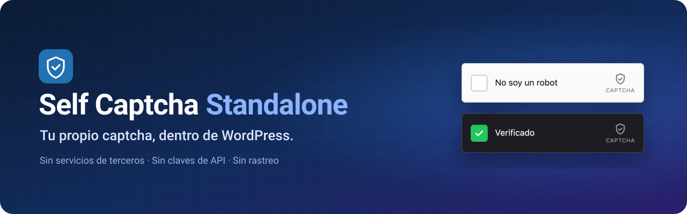
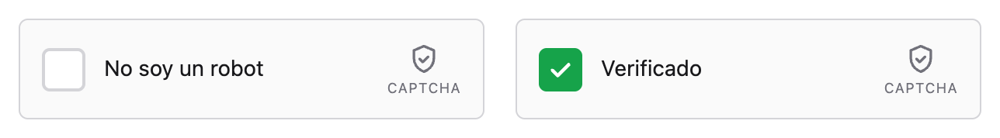
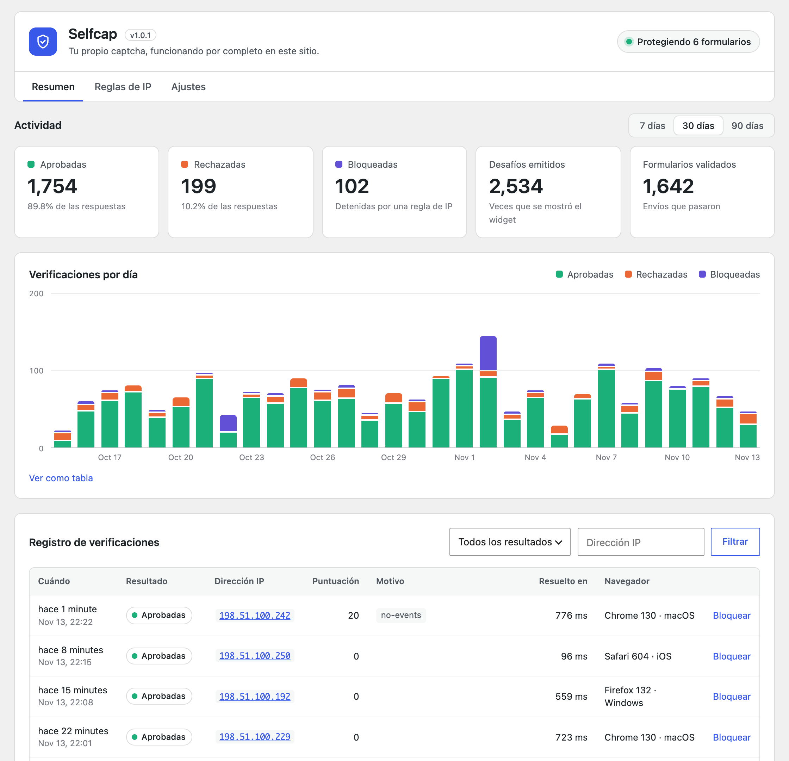
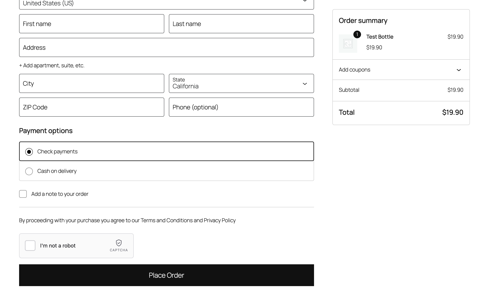
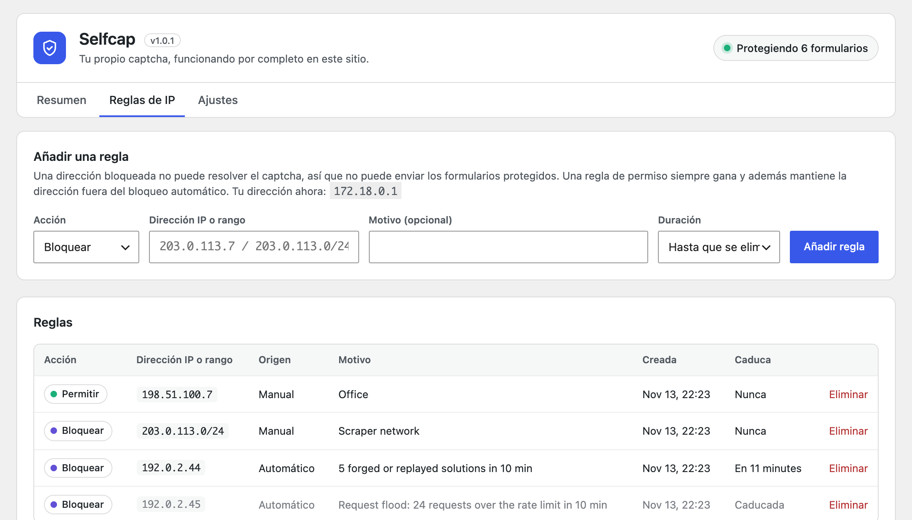
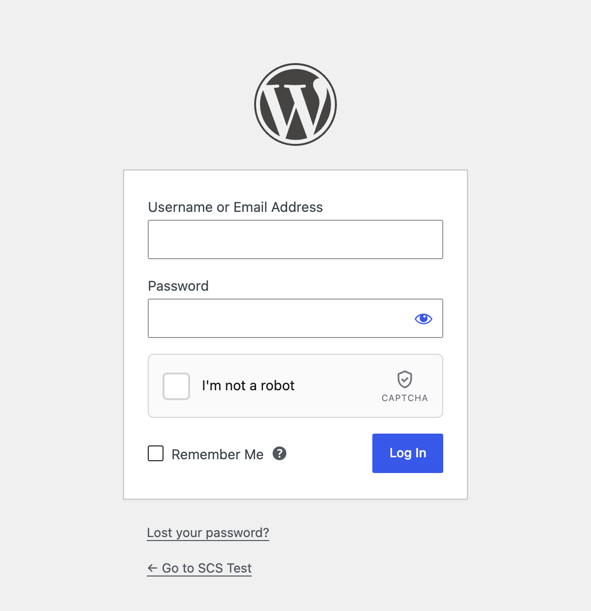
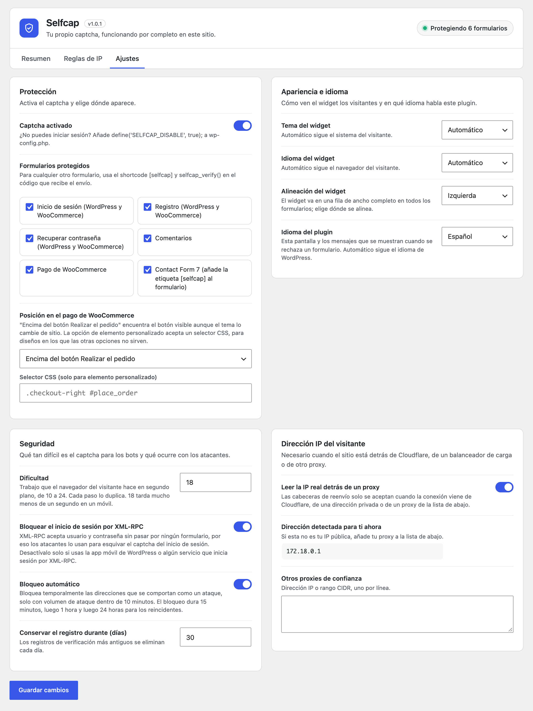
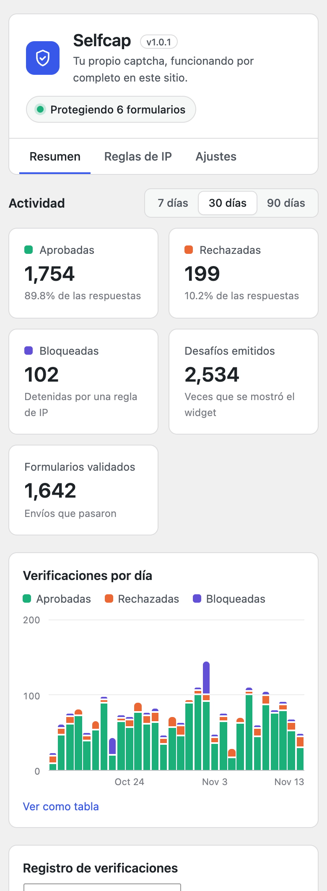
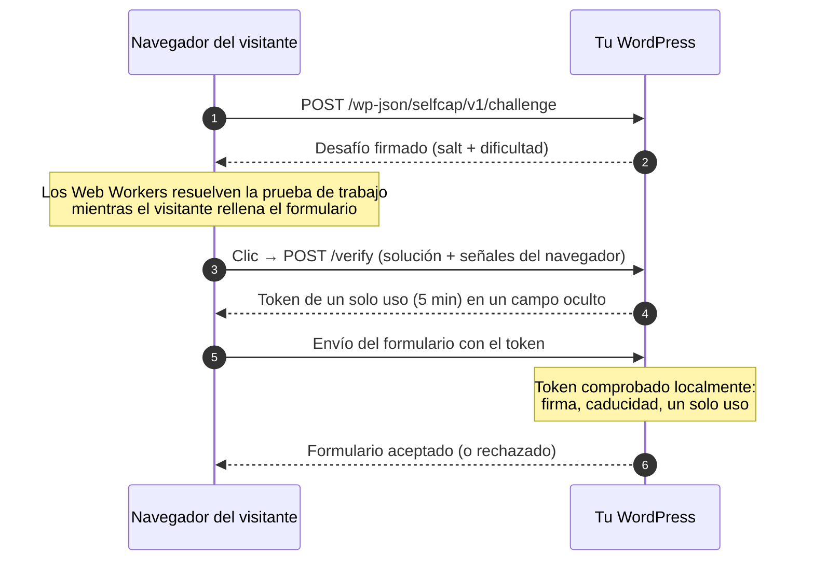

<p align="center">
  
</p>

<p align="center">
  
  
  
  
  
</p>

<p align="center">
  <a href="README.md">English</a> &nbsp;·&nbsp; <a href="README.pt-BR.md">Português</a> &nbsp;·&nbsp; <b>Español</b>
</p>

---

**Selfcap** protege los formularios de tu WordPress con una simple casilla de *"No soy un robot"*, y todo ocurre en tu propio sitio. WordPress emite el desafío, comprueba la respuesta, guarda el registro y bloquea a los atacantes. No hay servicios de terceros, ni cuentas que crear, ni claves de API, ni nada que se envíe a otra empresa.

<p align="center">
  <picture>
    <source media="(prefers-color-scheme: dark)" srcset="docs/images/widget-es-dark.png">
    
  </picture>
</p>

## Contenido

- [Por qué un captcha propio](#por-qué-un-captcha-propio)
- [Funciones](#funciones)
- [Capturas de pantalla](#capturas-de-pantalla)
- [Cómo funciona](#cómo-funciona)
- [Requisitos](#requisitos)
- [Instalación](#instalación)
- [Primeros pasos](#primeros-pasos)
- [Formularios compatibles](#formularios-compatibles)
- [Ajustes](#ajustes)
- [Proteger tus propios formularios](#proteger-tus-propios-formularios)
- [Hooks y constantes](#hooks-y-constantes)
- [API REST](#api-rest)
- [Modelo de seguridad](#modelo-de-seguridad)
- [Limitaciones conocidas](#limitaciones-conocidas)
- [IP del visitante detrás de un proxy](#ip-del-visitante-detrás-de-un-proxy)
- [Privacidad y datos](#privacidad-y-datos)
- [Solución de problemas](#solución-de-problemas)
- [Desarrollo](#desarrollo)
- [Cómo contribuir](#cómo-contribuir)
- [Licencia](#licencia)

## Por qué un captcha propio

Los servicios de captcha alojados funcionan bien, pero tienen un precio: el navegador de cada visitante habla con otra empresa, necesitas una cuenta y claves, y dependes de la disponibilidad y de las condiciones de otro. Selfcap lo mantiene todo dentro de tu WordPress.

| | Servicio de captcha alojado | Selfcap |
|---|---|---|
| El navegador del visitante contacta a un tercero | Sí | **No** |
| Cuenta y claves de API | Obligatorias | **Ninguna** |
| Dónde quedan los datos de las verificaciones | Servidores del proveedor | **Tu base de datos** |
| Funciona en una intranet o en un entorno de pruebas sin internet | Normalmente no | **Sí** |
| Rompecabezas o cuadrículas de imágenes | A veces | **Nunca, un clic** |
| Registro de cada verificación, con motivos | Limitado | **Completo, en wp-admin** |

## Funciones

**Protección**

- 🧮 **Prueba de trabajo.** El navegador del visitante resuelve un pequeño cálculo SHA-256 en Web Workers mientras carga la página. Las personas no lo notan; un bot que envía miles de peticiones paga por cada una.
- 🕵️ **Señales del navegador.** Se rechazan los navegadores automatizados (`webdriver`), los clics lanzados por script, los tiempos de clic imposibles y los user agents falsos.
- 🎟️ **Tokens de un solo uso.** Cada captcha resuelto va firmado, ligado a tu sitio y a la dirección del visitante, y sirve para un único envío de formulario en un máximo de 5 minutos. Se rechazan los tokens resueltos en otro lugar (una granja de solvers).
- 📈 **Límite de peticiones y dificultad adaptativa.** Cada 10 desafíos que una dirección pide en 10 minutos, los siguientes se vuelven el doble de difíciles. En IPv6 se cuenta por /64, así que cambiar de dirección no sirve.
- 🚫 **Bloqueo automático.** Las direcciones que se comportan como un ataque se bloquean temporalmente: 15 minutos, luego 1 hora y luego 24 horas para los reincidentes. Un cliente real que falla algunas veces nunca se bloquea, ni tampoco quienes comparten su dirección.
- 🔒 **Sin puertas traseras.** El inicio de sesión por XML-RPC queda cerrado, los formularios de WordPress y de WooCommerce comparten la misma opción para que uno no sirva de atajo para el otro, y ningún campo de la petición puede desactivar una comprobación.
- 🧱 **Reglas de IP.** Bloquea o permite cualquier dirección o rango CIDR (IPv4 e IPv6), de forma permanente o por un tiempo.

**Formularios**

- 🔐 Inicio de sesión, registro, recuperar contraseña y comentarios, en `wp-login.php`, en Mi cuenta de WooCommerce y en el registro de multisitio
- 🛒 Pago de WooCommerce, **tanto** en bloques como en el clásico `[woocommerce_checkout]`, con el widget justo encima del botón *Realizar el pedido*, además de la página *Pagar el pedido*
- ✉️ Contact Form 7, con la etiqueta `[selfcap]`
- 🧩 Cualquier otro formulario, con el shortcode `[selfcap]` y `selfcap_verify()`

**Panel**

- 📊 Totales y un gráfico diario de los últimos 7, 30 o 90 días, adaptable a cualquier pantalla y accesible con teclado, con vista de tabla
- 📜 Registro de verificaciones con resultado, puntuación, motivos, IP y navegador, con filtros y 10/25/50 por página
- ⚙️ Ajustes agrupados en tarjetas claras, con una insignia que muestra cuántos formularios están protegidos

**En todas partes**

- 🌍 Inglés, portugués y español, en el widget y en el panel
- 🌗 Tema del widget claro, oscuro o automático
- ☁️ IP real del visitante detrás de Cloudflare, de un balanceador de carga o de tu propio proxy
- 🧹 Limpieza diaria de los datos antiguos y limpieza completa al eliminar el plugin
- 🪶 Unos 12 KB de JavaScript en el widget, sin dependencias y sin cookies

## Capturas de pantalla

<table>
  <tr>
    <td width="50%"><br><sub><b>Resumen.</b> Totales, gráfico diario y el registro de verificaciones.</sub></td>
    <td width="50%"><br><sub><b>Pago de WooCommerce.</b> El widget queda justo encima de <i>Realizar el pedido</i>.</sub></td>
  </tr>
  <tr>
    <td><br><sub><b>Reglas de IP.</b> Bloqueos manuales y automáticos, con caducidad.</sub></td>
    <td><br><sub><b>Inicio de sesión.</b> Funciona en todos los formularios de WordPress.</sub></td>
  </tr>
</table>

<details>
<summary>Vistas de <b>ajustes</b> y <b>móvil</b></summary>
<br>
<p align="center">
  
  &nbsp;
  
</p>
</details>

## Cómo funciona



1. Cuando carga la página, el widget pide a tu sitio un **desafío firmado**. Los desafíos no guardan estado (HMAC), así que no cuesta nada almacenarlos.
2. Los **Web Workers** buscan un número cuyo hash SHA-256, junto con el salt del desafío, empiece con una cantidad dada de bits a cero. Con la dificultad por defecto tarda mucho menos de un segundo en un móvil.
3. Cuando el visitante hace clic en la casilla, el widget envía la solución y unas cuantas **señales del navegador** (si el clic fue real, cuánto tiempo pasó desde que apareció el widget, si se movió el puntero, si es un `webdriver`…). El sitio las puntúa.
4. Si todo cuadra, el sitio devuelve un **token de un solo uso**, que el widget guarda en un campo oculto `captcha-response`.
5. Cuando se envía el formulario, el plugin **valida el token localmente**: firma, caducidad y "nunca usado antes". Un token funciona exactamente una vez.

Nada de este flujo sale de tu servidor.

## Requisitos

| | Mínimo |
|---|---|
| WordPress | 6.3 |
| PHP | 7.4 (probado hasta 8.3) |
| Base de datos | MySQL o MariaDB, en las versiones que admite WordPress |
| Navegador | Cualquier navegador moderno. Usa Web Workers cuando se permite, con alternativa en el hilo principal |
| API REST | La ruta `/wp-json/selfcap/v1/` debe estar accesible para los visitantes |

WooCommerce y Contact Form 7 son opcionales. Sus opciones solo aparecen en los ajustes cuando esos plugins están activos.

## Instalación

**Desde un zip**

1. Descarga `selfcap-x.y.z.zip`, o genera uno a partir del código con `bin/build-zip.sh`.
2. En wp-admin ve a **Plugins → Añadir nuevo → Subir plugin**, elige el zip y actívalo.

**Desde el código**

```bash
cd wp-content/plugins
git clone https://github.com/christianoerick/selfcap.git
wp plugin activate selfcap
```

Al activarse, el plugin crea sus cuatro tablas y una clave de firma aleatoria. No hay nada más que configurar.

## Primeros pasos

1. **Activa el plugin.** El inicio de sesión, el registro, recuperar contraseña y los comentarios quedan protegidos al instante.
2. Abre **Selfcap → Ajustes** y marca los demás formularios que quieras proteger (WooCommerce, Contact Form 7).
3. **Solo en Contact Form 7:** añade la etiqueta `[selfcap]` a cada formulario, donde quieras que aparezca el widget.
4. Cierra sesión y abre la página de inicio de sesión. Verás el widget; la verificación es un clic.

> [!TIP]
> ¿Te quedaste fuera después de cambiar algún ajuste? Añade `define('SELFCAP_DISABLE', true);` a `wp-config.php`. El captcha queda desactivado hasta que quites la línea.

## Formularios compatibles

| Opción | Dónde aparece el widget | Cómo se comprueba el envío |
|---|---|---|
| **Inicio de sesión** | `wp-login.php` y los formularios de inicio de sesión de WooCommerce | `authenticate` en `wp-login.php`, `woocommerce_process_login_errors` en WooCommerce. El inicio de sesión por XML-RPC queda cerrado (ver Ajustes) |
| **Registro** | `wp-login.php?action=register`, Mi cuenta de WooCommerce, `wp-signup.php` de multisitio | `registration_errors`, `woocommerce_process_registration_errors`, `wpmu_validate_user_signup` |
| **Recuperar contraseña** | `wp-login.php?action=lostpassword` y Mi cuenta de WooCommerce | `lostpassword_post`, que disparan los dos. Los administradores que envían el enlace de restablecimiento desde la pantalla de Usuarios no se ven afectados |
| **Comentarios** | Encima del botón de enviar (oculto para los moderadores) | `preprocess_comment`. Los pingbacks y trackbacks no se ven afectados |
| **Pago de WooCommerce** | Encima de *Realizar el pedido* en el pago en bloques y en la página *Pagar el pedido*; en el pago clásico, donde elijas (ver Ajustes) | Store API (`woocommerce_store_api_checkout_update_order_from_request`, al realizar el pedido), `woocommerce_after_checkout_validation`, `woocommerce_before_pay_action` |
| **Contact Form 7** | Donde pongas `[selfcap]` | `wpcf7_spam`. Solo se comprueban los formularios que tienen la etiqueta |

Cada opción cubre todos los formularios de su tipo: proteger el *Inicio de sesión* protege `wp-login.php` **y** el inicio de sesión de WooCommerce, así que uno nunca sirve de atajo para el otro.

Los formularios que se envían sin recargar la página ya están cubiertos: después de un intento rechazado el widget vuelve a pedir la verificación, y en el pago clásico sobrevive a la actualización de totales de WooCommerce sin perder una verificación ya hecha.

## Ajustes

Todos los ajustes están en **Selfcap → Ajustes**.

| Ajuste | Por defecto | Qué hace |
|---|---|---|
| Captcha activado | Activado | Interruptor general |
| Formularios protegidos | Inicio de sesión, registro, recuperar contraseña, comentarios | Dónde se muestra y se comprueba el widget |
| Bloquear el inicio de sesión por XML-RPC | Activado | Cierra el inicio de sesión por XML-RPC, el atajo clásico para esquivar un captcha de inicio de sesión. Desactívalo solo para la app móvil de WordPress o un servicio que inicia sesión por XML-RPC |
| Tema del widget | Automático | Claro, oscuro, o según el sistema del visitante |
| Idioma del widget | Automático | Inglés, portugués, español, o según el navegador del visitante |
| Alineación del widget | Izquierda | Izquierda, centro o derecha. El widget mantiene su propio ancho dentro de una fila de ancho completo |
| Posición en el pago de WooCommerce | Encima del botón Realizar el pedido | Pago clásico: encima del botón *Realizar el pedido* visible (lo sigue cuando el tema lo mueve o lo duplica), antes o después del pago, antes o después de los datos de facturación, o antes de cualquier elemento indicado con un selector CSS |
| Idioma del plugin | Automático | Idioma del panel y de los mensajes de error. Automático sigue a WordPress |
| Dificultad | 18 | Bits de la prueba de trabajo, de 10 a 24. Cada paso duplica el trabajo |
| Bloqueo automático | Activado | Bloqueos temporales ante volumen de ataque |
| Conservar el registro durante | 30 días | Los registros más antiguos se eliminan cada día |
| Leer la IP real detrás de un proxy | Activado | Acepta cabeceras de reenvío de Cloudflare, de direcciones privadas y de los proxies de abajo |
| Otros proxies de confianza | Vacío | IPs o rangos CIDR adicionales que pueden enviar cabeceras de reenvío |

## Proteger tus propios formularios

**Shortcode en el formulario, una función en el código que recibe el envío.**

```php
<form method="post" action="<?php echo esc_url(admin_url('admin-post.php')); ?>">
    <input type="hidden" name="action" value="mi_boletin">
    <input type="email" name="email" required>

    <?php echo do_shortcode('[selfcap]'); ?>

    <button type="submit">Suscribirme</button>
</form>
```

```php
add_action('admin_post_nopriv_mi_boletin', 'mi_boletin');
add_action('admin_post_mi_boletin', 'mi_boletin');

function mi_boletin(): void
{
    if (! selfcap_verify()) {
        wp_die('Confirma que no eres un robot.', '', ['response' => 403, 'back_link' => true]);
    }

    // ...el envío viene de una persona, sigue adelante.
}
```

`selfcap_verify()` lee el token de `$_POST['captcha-response']`. También puedes pasarle el token: `selfcap_verify($token)`. Devuelve `true` o `false`, y llamarla dos veces en la misma petición no gasta el token dos veces.

**Atributos del shortcode**

| Atributo | Valores | Por defecto |
|---|---|---|
| `theme` | `auto`, `light`, `dark` | El ajuste |
| `language` | `auto`, `en`, `pt`, `es` | El ajuste |
| `align` | `left`, `center`, `right` | El ajuste |

```text
[selfcap theme="dark" language="es"]
```

**API de JavaScript.** Los formularios que se envían con `fetch` o AJAX pueden usar la API del widget para leer el token y volver a pedirlo después de un rechazo:

```js
const casilla = document.querySelector('#mi-form .self-captcha');

const token = SelfCaptcha.getResponse(casilla); // '' hasta que el visitante marque la casilla
// ...envía el formulario con el token...
SelfCaptcha.reset(casilla);                     // el token ya se usó: muestra una casilla nueva
```

| Método | Qué hace |
|---|---|
| `SelfCaptcha.getResponse(destino?)` | Token actual, o `''` |
| `SelfCaptcha.reset(destino?)` | Vuelve a la casilla sin marcar con un desafío nuevo |
| `SelfCaptcha.render(elemento, opciones?)` | Muestra un widget añadido después de cargar la página |
| `SelfCaptcha.remove(destino?)` | Elimina un widget |

`destino` es el elemento contenedor, un selector CSS o el id que devuelve `render()`; sin él se usa el primer widget de la página.

## Hooks y constantes

Filtro **`selfcap_config`**: todos los valores de ajuste fino en un solo array.

```php
add_filter('selfcap_config', function (array $config): array {
    $config['token_ttl'] = 900;                // pagos que tardan
    $config['auto_block']['durations'] = [30, 240, 2880];

    return $config;
});
```

<details>
<summary>Todas las claves y sus valores por defecto</summary>

| Clave | Por defecto | Significado |
|---|---|---|
| `challenge_ttl` | `180` | Segundos de validez de un desafío |
| `token_ttl` | `300` | Segundos de validez de un token antes de enviar el formulario |
| `bind_token_ip` | `true` | El formulario debe venir de la dirección (del /64 en IPv6) que resolvió el captcha |
| `difficulty` | ajuste (`18`) | Bits base de la prueba de trabajo |
| `min_difficulty` / `max_difficulty` | `10` / `24` | Límites, con el extra adaptativo incluido |
| `adaptive_step` | `10` | Desafíos por IP en 10 minutos que suman un bit |
| `adaptive_max_bonus` | `5` | Máximo de bits extra |
| `score_block` | `100` | Una verificación con esta puntuación o más se rechaza |
| `min_click_ms` | `250` | Los clics más rápidos que esto tras aparecer el widget se rechazan |
| `rate.challenge` / `rate.verify` | `30` / `30` | Peticiones por minuto por IP |
| `auto_block.enabled` | ajuste (activado) | Interruptor del bloqueo automático |
| `auto_block.window` | `600` | Ventana de conteo, en segundos |
| `auto_block.fails` | `8` | Verificaciones rechazadas que disparan el bloqueo… |
| `auto_block.fail_ratio` | `4` | …salvo que las aprobadas × 4 superen a las rechazadas (también vale para `rate_limited`) |
| `auto_block.bad_solutions` | `10` | Soluciones erróneas o repetidas para desafíos legítimos |
| `auto_block.bot_signals` | `5` | Verificaciones marcadas como automatización |
| `auto_block.login_fails` | `20` | Inicios de sesión con contraseña errónea |
| `auto_block.rate_limited` | `20` | Peticiones rechazadas por el límite |
| `auto_block.passes` | `100` | Verificaciones aprobadas (solo volumen extremo) |
| `auto_block.wide_after` | `16` | /64 de un mismo /48 de IPv6 bloqueados por automatización, rechazos o contraseñas erróneas en un día, que bloquean el /48 entero |
| `auto_block.durations` | `[15, 60, 1440]` | Minutos de bloqueo en la 1.ª, 2.ª y siguientes infracciones |
| `auto_block.memory_days` | `7` | Cuánto tiempo se recuerdan las infracciones anteriores |

</details>

Filtro **`selfcap_hostnames`**: dominios adicionales donde puede funcionar el widget (mapeo de dominios, un segundo dominio de idioma). Las URL del sitio y de la portada siempre se aceptan, con y sin `www.`.

```php
add_filter('selfcap_hostnames', fn (array $hosts) => [...$hosts, 'tienda.ejemplo.es']);
```

Constante **`SELFCAP_DISABLE`**: `define('SELFCAP_DISABLE', true);` en `wp-config.php` lo desactiva todo.

Función **`selfcap_verify(?string $token = null): bool`**: valida el envío actual, como se muestra arriba.

## API REST

El widget habla con dos rutas públicas de tu propio sitio. Solo las necesitas si construyes tu propio widget.

| Ruta | Cuerpo | Éxito |
|---|---|---|
| `POST /wp-json/selfcap/v1/challenge` | `{}` | `{ success, challenge, salt, difficulty, expires_in }` |
| `POST /wp-json/selfcap/v1/verify` | `{ challenge, nonce, signals }` | `{ success, token, expires_in }` |

Los errores vuelven como `{ "success": false, "error": "<código>" }`:

| Código | Significado |
|---|---|
| `domain-not-allowed` | La petición no vino de las páginas de este sitio |
| `blocked` | La dirección coincide con una regla de bloqueo |
| `rate-limited` | Demasiadas peticiones de esta dirección en el último minuto |
| `invalid-challenge` / `challenge-expired` / `challenge-used` | Desafío falsificado, caducado o ya usado |
| `ip-mismatch` | El desafío se emitió para otra dirección |
| `invalid-solution` | La prueba de trabajo no cuadra |
| `verification-failed` | Las señales del navegador puntuaron como bot |
| `site-disabled` | El captcha está desactivado |

## Modelo de seguridad

Conviene ser claro sobre lo que un captcha puede y no puede hacer. **Las señales del navegador se pueden falsificar** por un atacante decidido que escriba un bot específicamente para tu sitio. Lo que encarece el abuso es la combinación:

- la **prueba de trabajo**, que se paga en cada intento y se endurece a medida que crece el volumen;
- el **límite de peticiones** por dirección;
- los **tokens de un solo uso**, que no se pueden repetir, compartir entre sitios ni usar desde una dirección distinta de la que los resolvió — y nunca desde una dirección bloqueada;
- el **bloqueo automático** de las direcciones que insisten en fallar, falsificar o inundar;
- **ninguna puerta trasera**: inicio de sesión por XML-RPC cerrado, una opción por tipo de formulario, comprobaciones decididas por el punto de entrada y nunca por un campo que envía el cliente;
- un **widget blindado**: solo habla con tu propio sitio y solo acepta respuestas bien formadas, así que el HTML inyectado en una entrada no puede volverlo contra un administrador.

<details>
<summary>Cómo se puntúa una verificación</summary>

Una verificación se rechaza con una puntuación de **100** o más.

| Señal | Puntos |
|---|---|
| Indicador `webdriver` informado por el navegador | 100 |
| User agent de bot (headless, curl, python-requests…) | 100 |
| Clic no confiable (lanzado por un script) | 100 |
| Clic a menos de 250 ms de aparecer el widget | 100 |
| El user agent de la página no coincide con la cabecera de la petición | 50 |
| Clic de ratón sin movimiento del puntero | 40 |
| Sin cabecera `Accept-Language` | 30 |
| Navegador sin idiomas | 30 |
| Sin tamaño de pantalla | 30 |
| Dice ser Chrome sin el runtime de Chrome | 30 |
| Sin tamaño de ventana | 20 |
| Ninguna actividad del usuario en la página | 20 |

Quien usa teclado o pantalla táctil se evalúa con sus propias reglas: de ellos no se espera movimiento del puntero.

</details>

<details>
<summary>Cuándo se bloquea una dirección automáticamente</summary>

El conteo es por dirección IPv4, o por **/64** en IPv6, dentro de 10 minutos.

| Disparador | Umbral | Por qué un cliente nunca llega |
|---|---|---|
| Verificaciones rechazadas | 8, y solo si las aprobadas × 4 no las superan | Las aprobaciones desde una IP compartida (oficina, operadora) frenan el bloqueo |
| Soluciones erróneas o repetidas para desafíos legítimos | 10 | El widget real nunca envía algo así. La basura sin firma no cuenta, porque no cuesta nada enviarla |
| Automatización del navegador detectada | 5 | Los navegadores normales no informan `webdriver` |
| Inicios de sesión con contraseña errónea | 20 | Nadie se equivoca de contraseña 20 veces en 10 minutos |
| Peticiones por encima del límite | 20 | Ya supone más de 30 peticiones por minuto |
| Captchas resueltos por una dirección | 100 | Nadie completa 100 formularios en 10 minutos |

Para las verificaciones rechazadas y las inundaciones de peticiones, las verificaciones aprobadas desde la misma dirección frenan el bloqueo (las aprobadas × 4 deben quedar por debajo del conteo), así que una persona malintencionada detrás del NAT de una operadora, de una oficina o de una escuela no puede hacer que bloqueen a todos los demás. Los demás disparadores bloquean directamente, así que un bot no puede proteger su dirección resolviendo antes algunos captchas. En IPv6, 16 /64 de un mismo /48 bloqueados en un día por automatización, rechazos o contraseñas erróneas bloquean el /48 entero.

El bloqueo dura **15 minutos**, luego **1 hora** y luego **24 horas** para las reincidencias en 7 días. **Las reglas de permiso siempre ganan**, y **las direcciones privadas nunca se bloquean**: si tu proxy no se reconoce, todos los visitantes compartirían su dirección, y bloquearla bloquearía a todo el mundo.

</details>

## Limitaciones conocidas

- **Los botones de pago exprés** (Apple Pay, Google Pay y botones parecidos que aparecen antes del formulario de pago) realizan el pedido sin el widget. Con el *Pago de WooCommerce* protegido, se rechazan hasta que el visitante marque la casilla. Pruébalos en tu tienda y desactiva la opción del pago si dependes de ellos.
- **Los formularios propios de otros plugins** para iniciar sesión o registrarse (el inicio de sesión AJAX de un tema, un plugin de membresías) no muestran el widget, así que no se comprueban. Protégelos con el shortcode y `selfcap_verify()`.
- **Los usuarios con sesión iniciada** que comentan por la API REST no pasan por el captcha; es en el registro donde se frena a los bots.
- **Una CDN o proxy con direcciones públicas** que no sea Cloudflare (CloudFront, Sucuri, Fastly…) debe añadirse en *Otros proxies de confianza*. Mientras tanto, todos los visitantes comparten las direcciones de la CDN.

## IP del visitante detrás de un proxy

Detrás de Cloudflare, de un balanceador de carga o de un proxy inverso, la conexión viene del proxy, no del visitante. El plugin lee las cabeceras de reenvío (`CF-Connecting-IP`, `X-Forwarded-For`) **solo** cuando la propia conexión viene de:

- **Cloudflare**, según los rangos IPv4 e IPv6 que publica;
- una **dirección privada** (balanceadores de AWS, Google Cloud o Azure, Docker, un Nginx local);
- un proxy que añadas en **Otros proxies de confianza**.

Un visitante que se conecta directamente no puede falsificar esas cabeceras. La pantalla de ajustes muestra la dirección detectada para ti en este momento; si no es tu IP pública, añade tu proxy a la lista. Detrás de CloudFront, añade allí los rangos de CloudFront.

## Privacidad y datos

- **Ninguna petición externa.** Ni el widget ni el plugin contactan con ningún servicio de fuera. No se crea ninguna cookie.
- **Qué se guarda**, en tu propia base de datos, por cada verificación: dirección IP, user agent, dominio, puntuación, resultado, motivos y tiempo de resolución. Por defecto se conserva 30 días.
- **Política de privacidad.** Se añade un párrafo sugerido en **Ajustes → Privacidad** para que lo incluyas en tu política.

| Tabla | Contiene |
|---|---|
| `{prefix}selfcap_log` | Una fila por verificación |
| `{prefix}selfcap_stats` | Totales diarios (se conservan unos 13 meses) |
| `{prefix}selfcap_rules` | Reglas de IP manuales y automáticas |
| `{prefix}selfcap_counters` | Contadores de vida corta: límite de peticiones, detección de ataques, tokens usados |

Una tarea diaria del cron elimina los datos caducados. **Eliminar el plugin** desde la pantalla de Plugins borra las cuatro tablas, sus opciones y las preferencias de los usuarios.

## Solución de problemas

<details>
<summary><b>El widget dice "Verificación no disponible" o "Verificación fallida"</b></summary>

- **"Verificación no disponible"** significa que el sitio rechazó el widget: el captcha está desactivado, o la página está en un dominio distinto del sitio WordPress. Añade ese dominio con el filtro `selfcap_hostnames`.
- **"Verificación fallida"** justo después del clic, siempre, suele significar que el widget no llega a `/wp-json/selfcap/v1/`. Comprueba que ningún plugin de seguridad ni regla de firewall esté cerrando la API REST a los visitantes. El registro del **Resumen** muestra el motivo cuando la petición sí llegó.
</details>

<details>
<summary><b>Todos aparecen con la misma IP en el registro</b></summary>

Tu sitio está detrás de un proxy que el plugin no reconoce; la pantalla del panel muestra un aviso cuando ocurre. Abre **Ajustes → Dirección IP del visitante**, compara la dirección detectada con la tuya y añade el proxy en **Otros proxies de confianza**. Mientras tanto, el bloqueo automático no actúa sobre direcciones privadas, así que nadie se queda fuera.
</details>

<details>
<summary><b>Ya no puedo iniciar sesión</b></summary>

Añade `define('SELFCAP_DISABLE', true);` a `wp-config.php`, inicia sesión, corrige el ajuste y quita la línea. O añade tu IP como regla de **Permitir**.
</details>

<details>
<summary><b>El pago tarda más de 5 minutos</b></summary>

El widget se renueva solo cuando caduca el token, así que el visitante solo vuelve a hacer clic. Para dar más tiempo, sube `token_ttl` con el filtro `selfcap_config`.
</details>

<details>
<summary><b>¿Funciona con caché de página?</b></summary>

Sí. La página se puede cachear con normalidad; el widget pide su desafío en una petición aparte, sin caché, después de que carga la página.
</details>

<details>
<summary><b>¿Puedo usarlo junto con otro plugin de captcha?</b></summary>

Puedes, pero no tiene sentido proteger el mismo formulario dos veces. Desactiva el otro plugin en los formularios elegidos aquí.
</details>

## Desarrollo

```text
selfcap/
├── selfcap.php   Arranque: constantes, includes, hooks
├── includes/
│   ├── class-selfcap-engine.php  Desafío, prueba de trabajo, puntuación, tokens, bloqueo automático
│   ├── class-selfcap-store.php   Tablas, contadores, registro, totales, reglas de IP
│   ├── class-selfcap-ip.php      Rangos CIDR e IP real del visitante
│   ├── class-selfcap-plugin.php  Opciones, traducciones, HTML del widget, verify()
│   ├── class-selfcap-rest.php    Las dos rutas REST
│   ├── class-selfcap-forms.php   Hooks de WordPress, WooCommerce y Contact Form 7
│   └── class-selfcap-admin.php   La pantalla del panel
├── assets/
│   ├── widget.js                 Widget compilado (código en assets/src/)
│   ├── forms.js                  Integración con formularios AJAX y los dos pagos
│   ├── admin.css / admin.js      Pantalla del panel
│   └── src/                      Código legible del widget
├── languages/                    .pot, pt_BR y es_ES
├── tests/run.php                 Pruebas de integración
└── bin/build-zip.sh              Genera el zip de distribución
```

**Vuelve a compilar el widget** después de cambiar `assets/src/`:

```bash
npx esbuild assets/src/widget.js --bundle --minify --format=iife --target=es2017 --outfile=assets/widget.js
```

**Ejecuta las pruebas** en un sitio desechable. Vacían las tablas del plugin.

```bash
wp eval-file wp-content/plugins/selfcap/tests/run.php
# OK - 93 checks passed
```

Cubren el flujo completo, desafíos y tokens falsificados o repetidos, tokens usados desde otra dirección o desde una bloqueada, la comprobación de dominio, las señales del navegador, las reglas de IP (también con miles de reglas automáticas), el límite de peticiones y la dificultad adaptativa, cada disparador del bloqueo automático, las contraseñas erróneas, las direcciones compartidas, el /64 y el /48 de IPv6, la detección de IP detrás de un proxy y la limpieza de datos.

**Actualiza las traducciones** después de cambiar un texto:

```bash
wp i18n make-pot . languages/selfcap.pot --exclude=tests,assets,docs
# traduce languages/*.po y después:
wp i18n make-mo languages
```

**Genera el zip de distribución** (solo los archivos que van en el plugin, mira `.distignore`):

```bash
bin/build-zip.sh
# dist/selfcap-1.0.1.zip
```

El plugin pasa el [Plugin Check](https://wordpress.org/plugins/plugin-check/) oficial sin errores ni avisos:

```bash
wp plugin check selfcap
```

## Cómo contribuir

Las issues y los pull requests son bienvenidos. Por favor:

1. Abre antes una issue para los cambios grandes, así acordamos el enfoque.
2. Mantén el plugin sin dependencias y todo dentro del sitio: nada de llamadas externas.
3. Ejecuta las pruebas y el Plugin Check antes de enviar el pull request.
4. Añade cada texto nuevo visible para el usuario en los tres idiomas.

¿Encontraste un fallo de seguridad? No abras una issue pública; usa el **informe privado de vulnerabilidades** de GitHub en este repositorio.

## Licencia

[GPL-2.0-or-later](LICENSE). © Christiano Erick.
