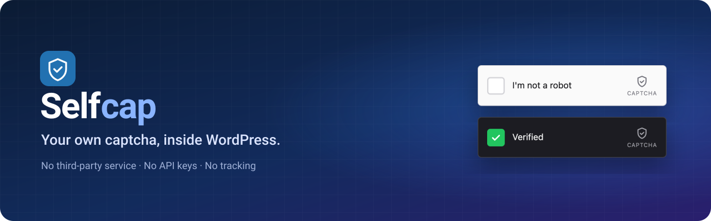
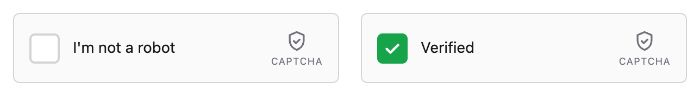
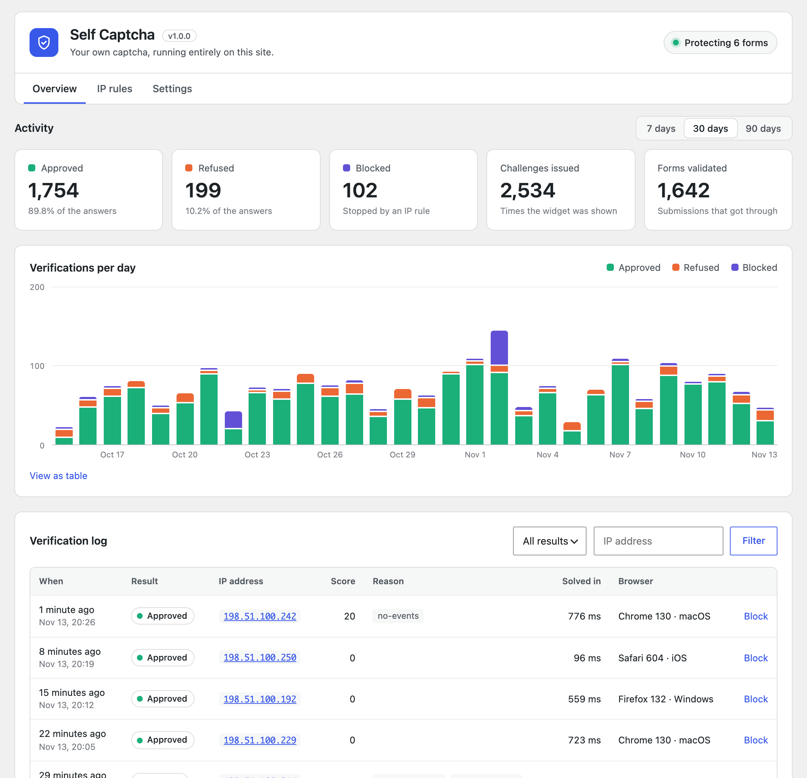
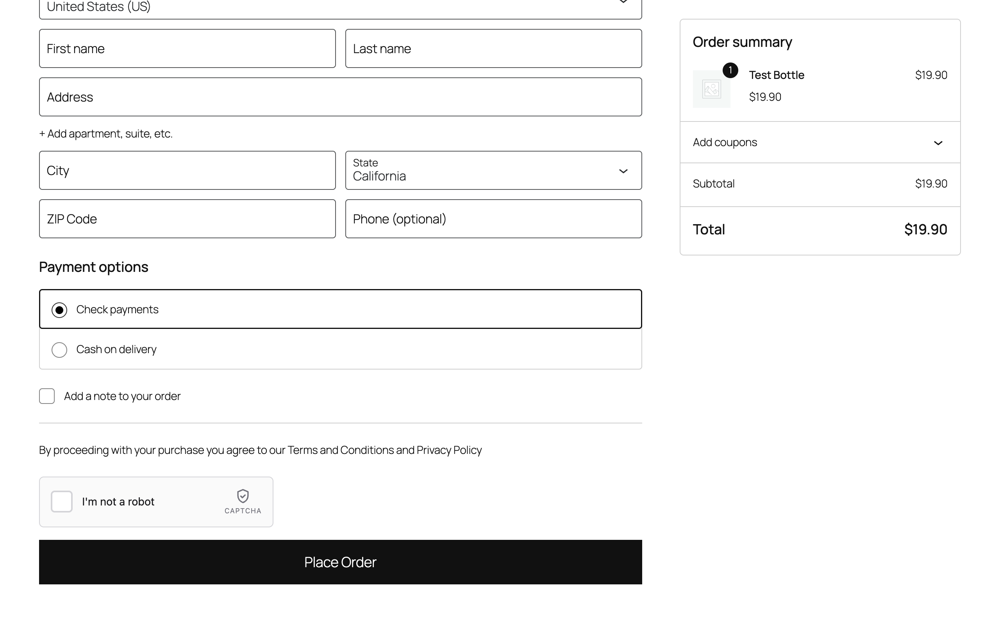
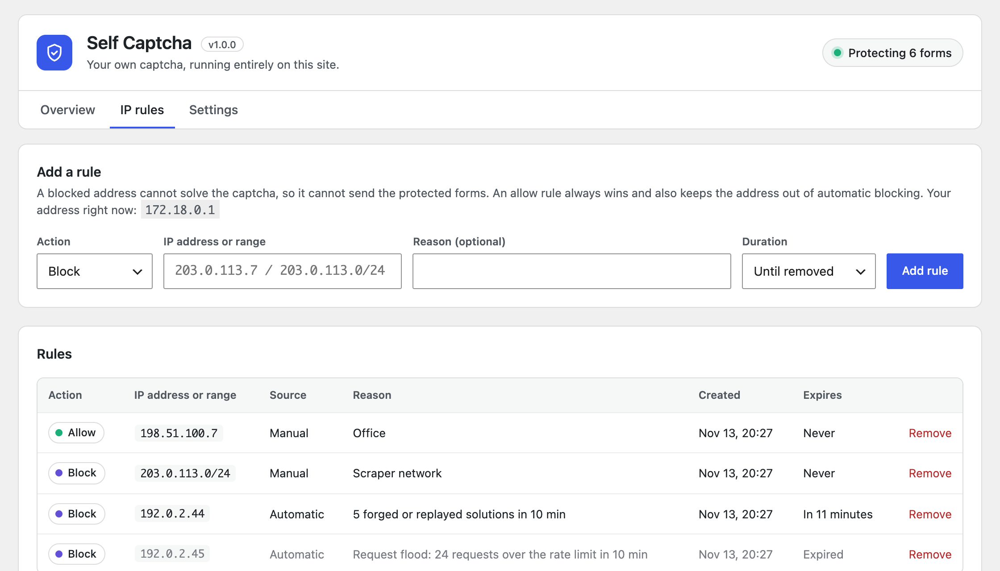
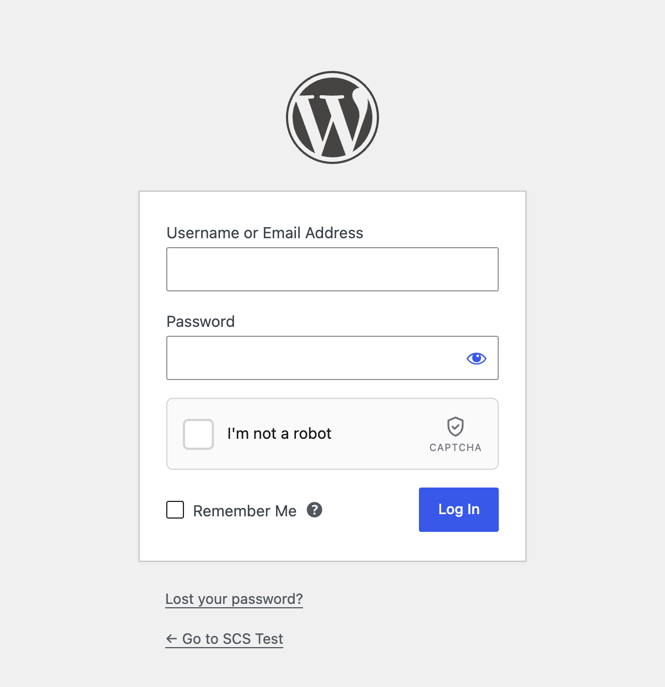
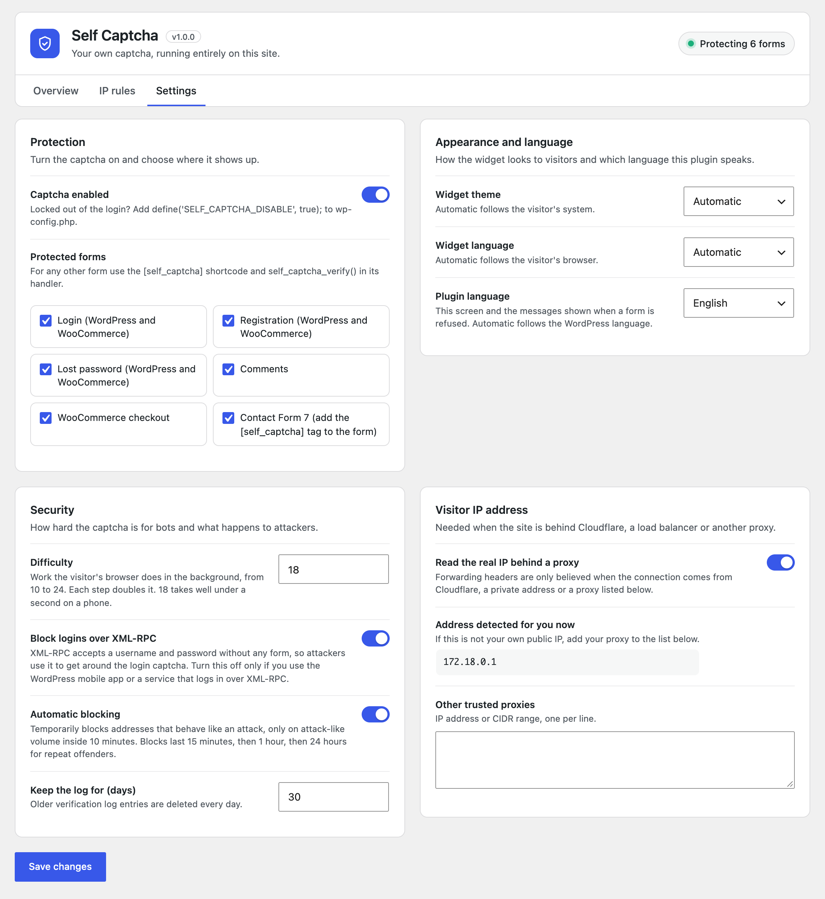
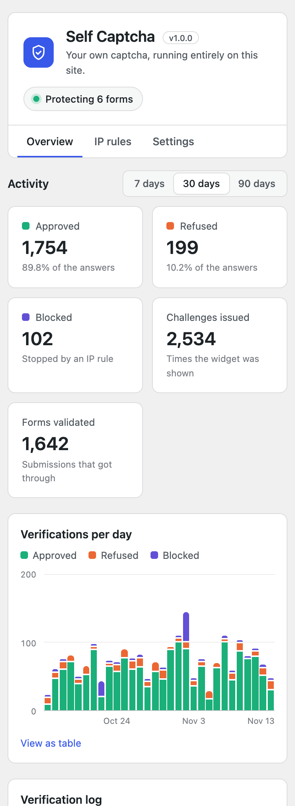
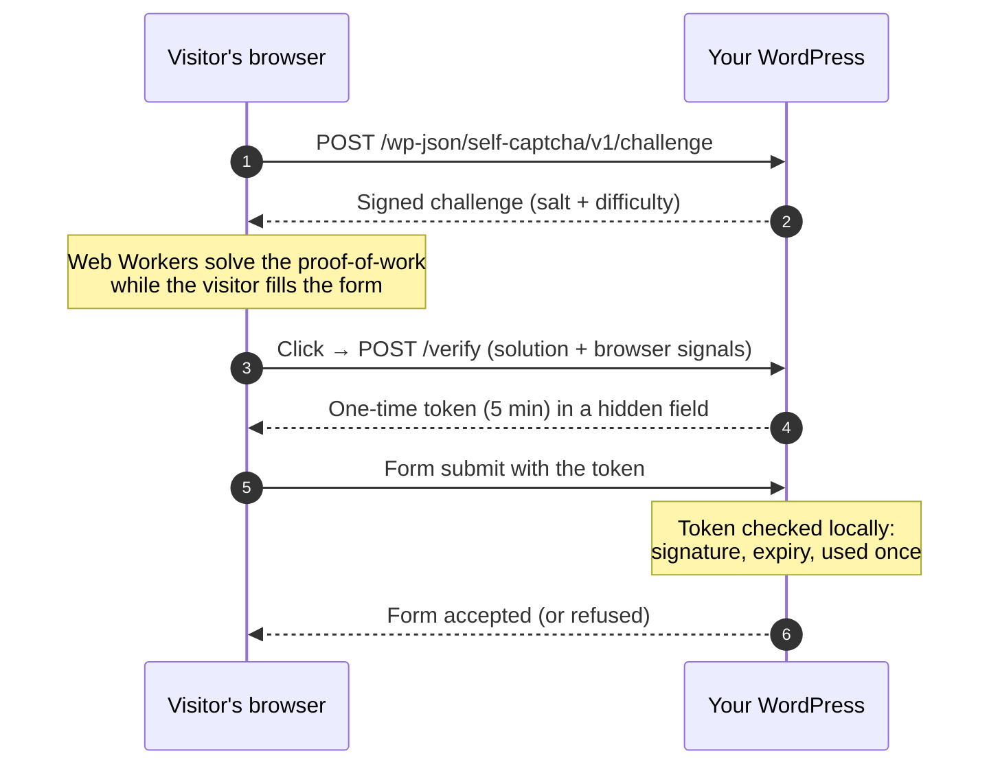

<p align="center">
  
</p>

<p align="center">
  
  
  
  
  
</p>

<p align="center">
  <b>English</b> &nbsp;·&nbsp; <a href="README.pt-BR.md">Português</a> &nbsp;·&nbsp; <a href="README.es.md">Español</a>
</p>

---

**Self Captcha Standalone** protects your WordPress forms with a simple *"I'm not a robot"* checkbox, and everything happens on your own site. WordPress issues the challenge, checks the answer, keeps the log and blocks attackers. There is no third-party service, no account to create, no API keys and nothing sent to anyone else.

<p align="center">
  <picture>
    <source media="(prefers-color-scheme: dark)" srcset="docs/images/widget-en-dark.png">
    
  </picture>
</p>

## Contents

- [Why a self-hosted captcha](#why-a-self-hosted-captcha)
- [Features](#features)
- [Screenshots](#screenshots)
- [How it works](#how-it-works)
- [Requirements](#requirements)
- [Installation](#installation)
- [Quick start](#quick-start)
- [Supported forms](#supported-forms)
- [Settings](#settings)
- [Protecting your own forms](#protecting-your-own-forms)
- [Hooks and constants](#hooks-and-constants)
- [REST API](#rest-api)
- [Security model](#security-model)
- [Known limitations](#known-limitations)
- [Visitor IP behind a proxy](#visitor-ip-behind-a-proxy)
- [Privacy and data](#privacy-and-data)
- [Troubleshooting](#troubleshooting)
- [Development](#development)
- [Contributing](#contributing)
- [License](#license)

## Why a self-hosted captcha

Hosted captcha services work well, but they come with strings attached: every visitor's browser talks to another company, you need an account and keys, and you depend on someone else's uptime and terms. Self Captcha Standalone keeps the whole thing in your WordPress.

| | Hosted captcha service | Self Captcha Standalone |
|---|---|---|
| Visitor's browser contacts a third party | Yes | **No** |
| Account and API keys | Required | **None** |
| Where verification data lives | Provider's servers | **Your database** |
| Works on an intranet or offline staging | Usually not | **Yes** |
| Puzzles or image grids for people | Sometimes | **Never, one click** |
| Log of every check, with reasons | Limited | **Full, in wp-admin** |

## Features

**Protection**

- 🧮 **Proof-of-work.** The visitor's browser solves a small SHA-256 computation in Web Workers while the page loads. People do not notice it; a bot sending thousands of requests pays for every single one.
- 🕵️ **Browser signals.** Automated browsers (`webdriver`), scripted clicks, impossible click timings and fake user agents are refused.
- 🎟️ **One-time tokens.** Each solved captcha is signed, tied to your site and to the visitor's address, and good for a single form submission within 5 minutes. Tokens solved somewhere else (a solver farm) are refused.
- 📈 **Rate limit and adaptive difficulty.** Every 10 challenges an address asks for in 10 minutes make the next ones twice as hard. IPv6 is counted per /64, so rotating addresses does not help.
- 🚫 **Automatic blocking.** Addresses that behave like an attack are blocked temporarily: 15 minutes, then 1 hour, then 24 hours for repeat offenders. A real customer who fails a few times is never blocked, and neither are the other people sharing their address.
- 🔒 **No side doors.** Login over XML-RPC is closed, WordPress and WooCommerce forms share one setting so neither is a way around the other, and no request field can switch a check off.
- 🧱 **IP rules.** Block or allow any address or CIDR range (IPv4 and IPv6), permanently or for a while.

**Forms**

- 🔐 Login, registration, lost password and comments, on `wp-login.php`, WooCommerce My Account and multisite sign-up
- 🛒 WooCommerce checkout, in **both** the block checkout and the classic `[woocommerce_checkout]`, with the widget right above the *Place order* button, plus the *Pay for order* page
- ✉️ Contact Form 7, with a `[self_captcha]` tag
- 🧩 Any other form, with the `[self_captcha]` shortcode and `self_captcha_verify()`

**Dashboard**

- 📊 Totals and a daily chart for the last 7, 30 or 90 days, responsive and keyboard accessible, with a table view
- 📜 Verification log with result, score, reasons, IP address and browser, filterable, 10/25/50 per page
- ⚙️ Settings grouped in clear cards, with a status badge showing how many forms are protected

**Everywhere**

- 🌍 English, Portuguese and Spanish, both in the widget and in the admin
- 🌗 Light, dark or automatic widget theme
- ☁️ Real visitor IP behind Cloudflare, a load balancer or your own proxy
- 🧹 Daily cleanup of old data, and a full cleanup when you delete the plugin
- 🪶 About 12 KB of JavaScript for the widget, no dependencies, no cookies

## Screenshots

<table>
  <tr>
    <td width="50%"><br><sub><b>Overview.</b> Totals, daily chart and the verification log.</sub></td>
    <td width="50%"><br><sub><b>WooCommerce checkout.</b> The widget sits right above <i>Place order</i>.</sub></td>
  </tr>
  <tr>
    <td><br><sub><b>IP rules.</b> Manual and automatic blocks, with expiry.</sub></td>
    <td><br><sub><b>Login.</b> Works on every core form.</sub></td>
  </tr>
</table>

<details>
<summary><b>Settings</b> and <b>mobile</b> views</summary>
<br>
<p align="center">
  
  &nbsp;
  
</p>
</details>

## How it works



1. When the page loads, the widget asks your site for a **signed challenge**. Challenges are stateless (HMAC), so they cost nothing to store.
2. **Web Workers** search for a number whose SHA-256 hash, together with the challenge salt, starts with a given number of zero bits. At the default difficulty this takes well under a second on a phone.
3. When the visitor clicks the checkbox, the widget sends the solution plus a handful of **browser signals** (was the click trusted, how long after the widget appeared, did the pointer move, is this a `webdriver`…). The site scores them.
4. If everything checks out, the site returns a **one-time token** that the widget puts in a hidden `captcha-response` field.
5. When the form is submitted, the plugin **validates the token locally**: signature, expiry and "never used before". A token works exactly once.

Nothing in this flow leaves your server.

## Requirements

| | Minimum |
|---|---|
| WordPress | 6.3 |
| PHP | 7.4 (tested up to 8.3) |
| Database | MySQL or MariaDB, as supported by WordPress |
| Browser | Any modern browser. Web Workers are used when allowed, with a main-thread fallback |
| REST API | The route `/wp-json/self-captcha/v1/` must be reachable by visitors |

WooCommerce and Contact Form 7 are optional. Their options show up in the settings only when those plugins are active.

## Installation

**From a release zip**

1. Download `self-captcha-standalone-x.y.z.zip`, or build one from source with `bin/build-zip.sh`.
2. In wp-admin go to **Plugins → Add New → Upload Plugin**, choose the zip and activate it.

**From source**

```bash
cd wp-content/plugins
git clone https://github.com/christianoerick/self-captcha-standalone.git
wp plugin activate self-captcha-standalone
```

On activation the plugin creates its four tables and a random signing key. There is nothing else to configure.

## Quick start

1. **Activate the plugin.** Login, registration, lost password and comments are protected right away.
2. Open **Self Captcha → Settings** and tick the other forms you want to protect (WooCommerce, Contact Form 7).
3. **Contact Form 7 only:** add the `[self_captcha]` tag to each form, where you want the widget to appear.
4. Log out and try the login page. You will see the widget; the check takes a click.

> [!TIP]
> Locked out after a misconfiguration? Add `define('SELF_CAPTCHA_DISABLE', true);` to `wp-config.php`. The captcha is switched off until you remove the line.

## Supported forms

| Setting | Where the widget appears | How the submission is checked |
|---|---|---|
| **Login** | `wp-login.php` and the WooCommerce login forms | `authenticate` on `wp-login.php`, `woocommerce_process_login_errors` on WooCommerce. XML-RPC login is closed (see Settings) |
| **Registration** | `wp-login.php?action=register`, WooCommerce My Account, multisite `wp-signup.php` | `registration_errors`, `woocommerce_process_registration_errors`, `wpmu_validate_user_signup` |
| **Lost password** | `wp-login.php?action=lostpassword` and WooCommerce My Account | `lostpassword_post`, which both fire. Administrators sending a reset link from the Users screen are not affected |
| **Comments** | Above the submit button (hidden for moderators) | `preprocess_comment`. Pingbacks and trackbacks are not affected |
| **WooCommerce checkout** | Above *Place order* on the block and the classic checkout, and on the *Pay for order* page | Store API (`woocommerce_store_api_checkout_update_order_from_request`, on placing the order), `woocommerce_after_checkout_validation`, `woocommerce_before_pay_action` |
| **Contact Form 7** | Wherever you place `[self_captcha]` | `wpcf7_spam`. Only forms that contain the tag are checked |

Each setting covers every form of its kind: protecting *Login* protects `wp-login.php` **and** WooCommerce's login, so one is never a way around the other.

Forms that submit without a page reload are handled for you: after a refused attempt the widget asks again, and on the classic checkout it survives WooCommerce's totals refresh without losing a solved check.

## Settings

All settings live in **Self Captcha → Settings**.

| Setting | Default | What it does |
|---|---|---|
| Captcha enabled | On | Master switch |
| Protected forms | Login, registration, lost password, comments | Where the widget is shown and checked |
| Block logins over XML-RPC | On | Closes XML-RPC login, the classic way around a login captcha. Turn it off only for the WordPress mobile app or a service that logs in over XML-RPC |
| Widget theme | Automatic | Light, dark, or follow the visitor's system |
| Widget language | Automatic | English, Portuguese, Spanish, or follow the visitor's browser |
| Plugin language | Automatic | Language of the admin screen and of the error messages. Automatic follows WordPress |
| Difficulty | 18 | Proof-of-work bits, from 10 to 24. Each step doubles the work |
| Automatic blocking | On | Temporary blocks on attack-like volume |
| Keep the log for | 30 days | Older log entries are deleted daily |
| Read the real IP behind a proxy | On | Trust forwarding headers from Cloudflare, private addresses and the proxies below |
| Other trusted proxies | Empty | Extra IPs or CIDR ranges allowed to set forwarding headers |

## Protecting your own forms

**Shortcode in the form, one function in the handler.**

```php
<form method="post" action="<?php echo esc_url(admin_url('admin-post.php')); ?>">
    <input type="hidden" name="action" value="my_newsletter">
    <input type="email" name="email" required>

    <?php echo do_shortcode('[self_captcha]'); ?>

    <button type="submit">Subscribe</button>
</form>
```

```php
add_action('admin_post_nopriv_my_newsletter', 'my_newsletter');
add_action('admin_post_my_newsletter', 'my_newsletter');

function my_newsletter(): void
{
    if (! self_captcha_verify()) {
        wp_die(esc_html__('Please confirm you are not a robot.'), '', ['response' => 403, 'back_link' => true]);
    }

    // ...the submission is from a person, carry on.
}
```

`self_captcha_verify()` reads the token from `$_POST['captcha-response']`. You can also pass the token yourself: `self_captcha_verify($token)`. It returns `true` or `false`, and calling it twice in the same request does not spend the token twice.

**Shortcode attributes**

| Attribute | Values | Default |
|---|---|---|
| `theme` | `auto`, `light`, `dark` | The setting |
| `language` | `auto`, `en`, `pt`, `es` | The setting |

```text
[self_captcha theme="dark" language="pt"]
```

**JavaScript API.** Forms that submit with `fetch` or AJAX can use the widget's API to read the token and ask again after a refusal:

```js
const box = document.querySelector('#my-form .self-captcha');

const token = SelfCaptcha.getResponse(box); // '' until the visitor has checked the box
// ...send the form with the token...
SelfCaptcha.reset(box);                     // the token is spent: show a fresh checkbox
```

| Method | What it does |
|---|---|
| `SelfCaptcha.getResponse(target?)` | Current token, or `''` |
| `SelfCaptcha.reset(target?)` | Back to an unchecked box with a fresh challenge |
| `SelfCaptcha.render(element, options?)` | Renders a widget that was added after page load |
| `SelfCaptcha.remove(target?)` | Removes a widget |

`target` is the container element, a CSS selector or the id returned by `render()`; without it the first widget on the page is used.

## Hooks and constants

**`self_captcha_config`** filter: every tuning value in one array.

```php
add_filter('self_captcha_config', function (array $config): array {
    $config['token_ttl'] = 900;                // checkouts that take long
    $config['auto_block']['durations'] = [30, 240, 2880];

    return $config;
});
```

<details>
<summary>All keys and their defaults</summary>

| Key | Default | Meaning |
|---|---|---|
| `challenge_ttl` | `180` | Seconds a challenge stays valid |
| `token_ttl` | `300` | Seconds a token stays valid before the form is sent |
| `bind_token_ip` | `true` | The form must come from the address (the /64 on IPv6) that solved the captcha |
| `difficulty` | setting (`18`) | Base proof-of-work bits |
| `min_difficulty` / `max_difficulty` | `10` / `24` | Bounds, adaptive bonus included |
| `adaptive_step` | `10` | Challenges per IP in 10 minutes that add one bit |
| `adaptive_max_bonus` | `5` | Maximum extra bits |
| `score_block` | `100` | A verification at or above this score is refused |
| `min_click_ms` | `250` | Clicks faster than this after the widget appears are refused |
| `rate.challenge` / `rate.verify` | `30` / `30` | Requests per minute per IP |
| `auto_block.enabled` | setting (on) | Automatic blocking switch |
| `auto_block.window` | `600` | Counting window, in seconds |
| `auto_block.fails` | `8` | Refused verifications that trigger a block… |
| `auto_block.fail_ratio` | `4` | …unless approved ones × 4 outnumber them (also applies to `rate_limited`) |
| `auto_block.bad_solutions` | `10` | Wrong or replayed solutions to genuine challenges |
| `auto_block.bot_signals` | `5` | Verifications flagged as automation |
| `auto_block.login_fails` | `20` | Failed logins (wrong password) |
| `auto_block.rate_limited` | `20` | Requests refused by the rate limit |
| `auto_block.passes` | `100` | Approved verifications (extreme volume only) |
| `auto_block.wide_after` | `16` | /64s inside one IPv6 /48 blocked for automation, refusals or failed logins in a day, that block the whole /48 |
| `auto_block.durations` | `[15, 60, 1440]` | Minutes blocked on the 1st, 2nd and later offence |
| `auto_block.memory_days` | `7` | How long past offences are remembered |

</details>

**`self_captcha_hostnames`** filter: extra hostnames the widget may run on (domain mapping, a second language domain). The site and home URLs are always allowed, with and without `www.`.

```php
add_filter('self_captcha_hostnames', fn (array $hosts) => [...$hosts, 'shop.example.org']);
```

**`SELF_CAPTCHA_DISABLE`** constant: `define('SELF_CAPTCHA_DISABLE', true);` in `wp-config.php` switches everything off.

**`self_captcha_verify(?string $token = null): bool`** function: validates the current submission, as shown above.

## REST API

The widget talks to two public routes on your own site. You only need them if you build your own widget.

| Route | Body | Success |
|---|---|---|
| `POST /wp-json/self-captcha/v1/challenge` | `{}` | `{ success, challenge, salt, difficulty, expires_in }` |
| `POST /wp-json/self-captcha/v1/verify` | `{ challenge, nonce, signals }` | `{ success, token, expires_in }` |

Errors come back as `{ "success": false, "error": "<code>" }`:

| Code | Meaning |
|---|---|
| `domain-not-allowed` | The request did not come from this site's pages |
| `blocked` | The address matches a block rule |
| `rate-limited` | Too many requests from this address in the last minute |
| `invalid-challenge` / `challenge-expired` / `challenge-used` | Forged, old or already used challenge |
| `ip-mismatch` | The challenge was issued to another address |
| `invalid-solution` | The proof-of-work does not check out |
| `verification-failed` | The browser signals scored as a bot |
| `site-disabled` | The captcha is switched off |

## Security model

Be clear about what a captcha can and cannot do. **Browser signals can be forged** by a dedicated attacker who writes a bot for your site specifically. What makes abuse expensive is the combination:

- the **proof-of-work**, paid for every attempt and harder as the volume grows;
- the **rate limit** per address;
- **one-time tokens** that cannot be replayed, shared between sites, or used from an address other than the one that solved them — and never from a blocked address;
- **automatic blocking** of addresses that keep failing, forging or flooding;
- **no side doors**: XML-RPC login closed, one setting per kind of form, checks decided by the entry point and never by a field the client sends;
- a **hardened widget**: it only talks to your own site, and only accepts well-formed answers, so markup injected into a post cannot turn it against an administrator.

<details>
<summary>How a verification is scored</summary>

A verification is refused at a score of **100** or more.

| Signal | Points |
|---|---|
| `webdriver` flag set by the browser | 100 |
| Bot user agent (headless, curl, python-requests…) | 100 |
| Click not trusted (dispatched by a script) | 100 |
| Click less than 250 ms after the widget appeared | 100 |
| User agent in the page differs from the request header | 50 |
| Mouse click with no pointer movement | 40 |
| No `Accept-Language` header | 30 |
| No browser languages | 30 |
| No screen size | 30 |
| Claims Chrome without Chrome's runtime | 30 |
| No window size | 20 |
| No user activity at all on the page | 20 |

Keyboard and touch users are scored on their own terms: no pointer movement is expected from them.

</details>

<details>
<summary>When an address is blocked automatically</summary>

Counting is per IPv4 address, or per **/64** on IPv6, inside 10 minutes.

| Trigger | Threshold | Why a customer never hits it |
|---|---|---|
| Refused verifications | 8, and only if approved ones × 4 do not outnumber them | Approvals from a shared office or carrier IP hold the block back |
| Wrong or replayed solutions to genuine challenges | 10 | The real widget never sends one. Unsigned garbage is not counted, since it costs nothing to send |
| Browser automation detected | 5 | Ordinary browsers do not report `webdriver` |
| Failed logins (wrong password) | 20 | Nobody mistypes their password 20 times in 10 minutes |
| Requests over the rate limit | 20 | Already means more than 30 requests a minute |
| Captchas solved by one address | 100 | Nobody completes 100 forms in 10 minutes |

For refused verifications and rate-limit floods, approved verifications from the same address hold the block back (approved × 4 must stay below the count), so one bad actor behind a carrier NAT, an office or a school cannot get everybody else blocked. The other triggers block outright, so a bot cannot shield its address by solving a few captchas first. On IPv6, 16 /64s of one /48 blocked within a day for automation, refusals or failed logins block the whole /48.

Blocks last **15 minutes**, then **1 hour**, then **24 hours** for repeat offences within 7 days. **Allow rules always win**, and **private addresses are never blocked**: if your proxy is not recognised, every visitor would share its address, and blocking it would block everybody.

</details>

## Known limitations

- **Express payment buttons** (Apple Pay, Google Pay and similar buttons shown before the checkout form) place the order without the widget. With *WooCommerce checkout* protected they are refused until the visitor ticks the box. Test them on your store, and turn the checkout option off if you rely on them.
- **Other plugins' own login or registration forms** (a theme's AJAX login, a membership plugin) do not show the widget, so they are not checked. Protect them with the shortcode and `self_captcha_verify()`.
- **Logged-in users** posting comments over the REST API are not asked for a captcha; registration is where bots are stopped.
- **A CDN or proxy with public addresses** that is not Cloudflare (CloudFront, Sucuri, Fastly…) must be listed under *Other trusted proxies*. Until it is, every visitor shares the CDN's addresses.

## Visitor IP behind a proxy

Behind Cloudflare, a load balancer or a reverse proxy, the connection comes from the proxy, not from the visitor. The plugin reads the forwarding headers (`CF-Connecting-IP`, `X-Forwarded-For`) **only** when the connection itself comes from:

- **Cloudflare**, using its published IPv4 and IPv6 ranges;
- a **private address** (AWS, Google Cloud or Azure load balancers, Docker, a local Nginx);
- a proxy you list under **Other trusted proxies**.

A visitor who connects directly cannot forge these headers. The settings screen shows the address detected for you right now; if it is not your own public IP, add your proxy to the list. Behind CloudFront, list CloudFront's ranges there.

## Privacy and data

- **No external requests.** Neither the widget nor the plugin contacts any outside service. No cookies are set.
- **What is stored**, in your own database, for each verification: IP address, user agent, hostname, score, result, reasons and solve time. Kept for 30 days by default.
- **Privacy policy.** A suggested paragraph is added under **Settings → Privacy** for you to include in your policy.

| Table | Holds |
|---|---|
| `{prefix}selfcap_log` | One row per verification |
| `{prefix}selfcap_stats` | Daily totals (kept about 13 months) |
| `{prefix}selfcap_rules` | Manual and automatic IP rules |
| `{prefix}selfcap_counters` | Short-lived counters: rate limit, attack detection, used tokens |

A daily cron job prunes expired data. **Deleting the plugin** from the Plugins screen drops the four tables and removes its options and user preferences.

## Troubleshooting

<details>
<summary><b>The widget says "Verification unavailable" or "Verification failed"</b></summary>

- **"Verification unavailable"** means the site refused the widget: the captcha is switched off, or the page is on a domain other than the WordPress site. Add that domain with the `self_captcha_hostnames` filter.
- **"Verification failed"** right after the click, every time, usually means the widget cannot reach `/wp-json/self-captcha/v1/`. Check that a security plugin or firewall rule is not closing the REST API to visitors. The **Overview** log shows the reason when the request did arrive.
</details>

<details>
<summary><b>Everyone shows up with the same IP in the log</b></summary>

Your site is behind a proxy the plugin does not recognise; the admin screen shows a warning when this happens. Open **Settings → Visitor IP address**, compare the detected address with your own, and add the proxy to **Other trusted proxies**. Until then automatic blocking does nothing for private addresses, so nobody gets locked out.
</details>

<details>
<summary><b>I can't log in any more</b></summary>

Add `define('SELF_CAPTCHA_DISABLE', true);` to `wp-config.php`, log in, fix the setting, and remove the line. Or add your IP as an **Allow** rule.
</details>

<details>
<summary><b>The checkout takes longer than 5 minutes</b></summary>

The widget renews itself when the token expires, so the visitor only clicks again. To give more time, raise `token_ttl` with the `self_captcha_config` filter.
</details>

<details>
<summary><b>Does it work with page caching?</b></summary>

Yes. The page can be cached as usual; the widget fetches its challenge with a separate, uncached request after the page loads.
</details>

<details>
<summary><b>Can I use it together with another captcha plugin?</b></summary>

You can, but there is no reason to protect the same form twice. Turn the other plugin off for the forms selected here.
</details>

## Development

```text
self-captcha-standalone/
├── self-captcha-standalone.php   Bootstrap: constants, includes, hooks
├── includes/
│   ├── class-selfcap-engine.php  Challenge, proof-of-work, scoring, tokens, auto-blocking
│   ├── class-selfcap-store.php   Tables, counters, log, stats, IP rules
│   ├── class-selfcap-ip.php      CIDR matching and real visitor IP
│   ├── class-selfcap-plugin.php  Options, translations, widget markup, verify()
│   ├── class-selfcap-rest.php    The two REST routes
│   ├── class-selfcap-forms.php   WordPress, WooCommerce and Contact Form 7 hooks
│   └── class-selfcap-admin.php   The admin screen
├── assets/
│   ├── widget.js                 Bundled widget (source in assets/src/)
│   ├── forms.js                  Glue for AJAX forms and both checkouts
│   ├── admin.css / admin.js      Admin screen
│   └── src/                      Readable widget source
├── languages/                    .pot, pt_BR and es_ES
├── tests/run.php                 Integration tests
└── bin/build-zip.sh              Release zip builder
```

**Rebuild the widget** after changing `assets/src/`:

```bash
npx esbuild assets/src/widget.js --bundle --minify --format=iife --target=es2017 --outfile=assets/widget.js
```

**Run the tests** on a throwaway site. They truncate the plugin's tables.

```bash
wp eval-file wp-content/plugins/self-captcha-standalone/tests/run.php
# OK - 93 checks passed
```

They cover the full flow, forged and replayed challenges and tokens, tokens used from another or a blocked address, hostname checks, browser signals, IP rules (also with thousands of automatic ones), rate limit and adaptive difficulty, every automatic-blocking trigger, failed logins, shared addresses, IPv6 /64 and /48 handling, proxy IP detection and data pruning.

**Update translations** after changing a string:

```bash
wp i18n make-pot . languages/self-captcha-standalone.pot --exclude=tests,assets,docs
# translate languages/*.po, then:
wp i18n make-mo languages
```

**Build a release zip** (only the files that ship, see `.distignore`):

```bash
bin/build-zip.sh
# dist/self-captcha-standalone-1.0.0.zip
```

The plugin passes the official [Plugin Check](https://wordpress.org/plugins/plugin-check/) with no errors or warnings:

```bash
wp plugin check self-captcha-standalone
```

## Contributing

Issues and pull requests are welcome. Please:

1. Open an issue first for larger changes, so we can agree on the approach.
2. Keep the plugin dependency-free and keep everything on the site: no external calls.
3. Run the tests and Plugin Check before sending a pull request.
4. Add every new user-facing string to the three languages.

Found a security issue? Please do not open a public issue; use GitHub's **private vulnerability reporting** on this repository instead.

## License

[GPL-2.0-or-later](LICENSE). © Christiano Erick.
