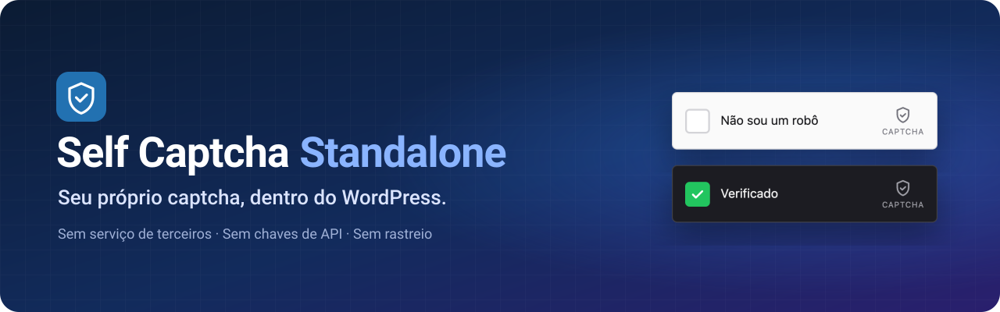
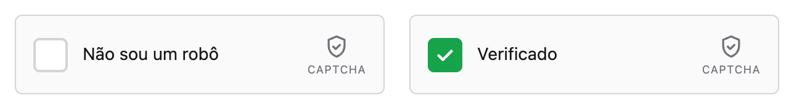
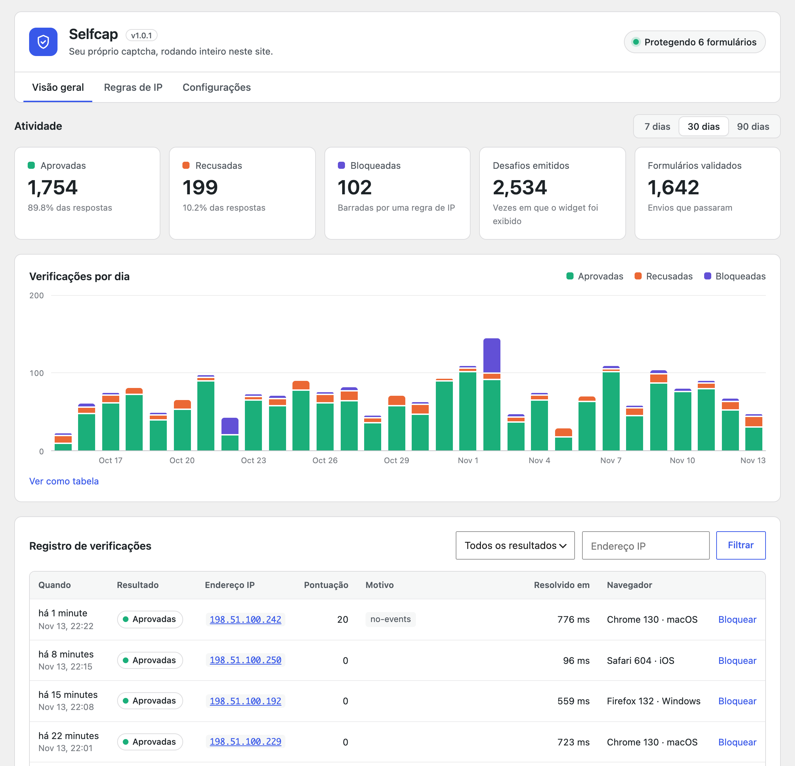
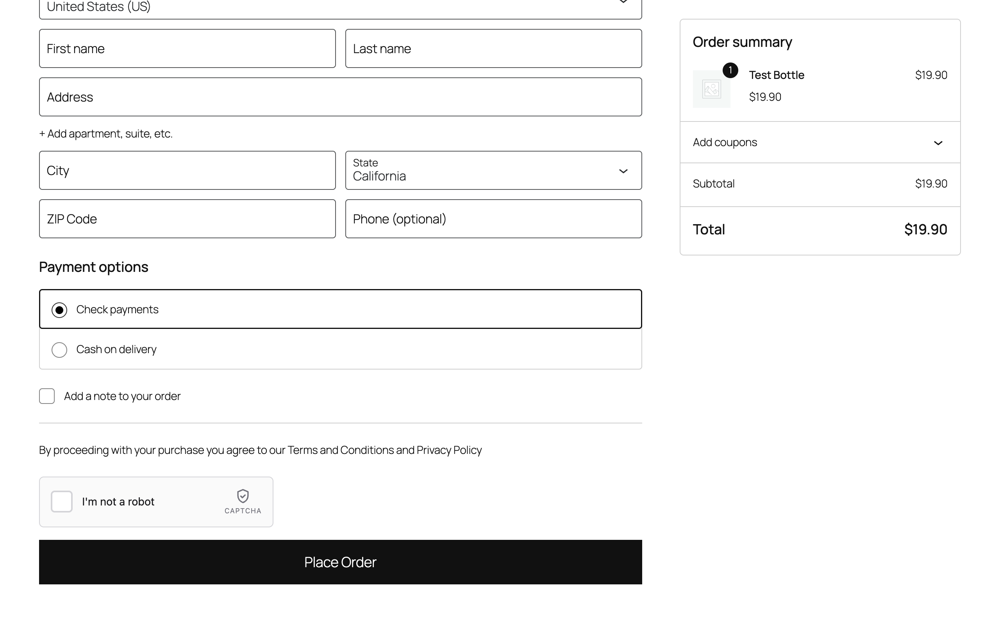
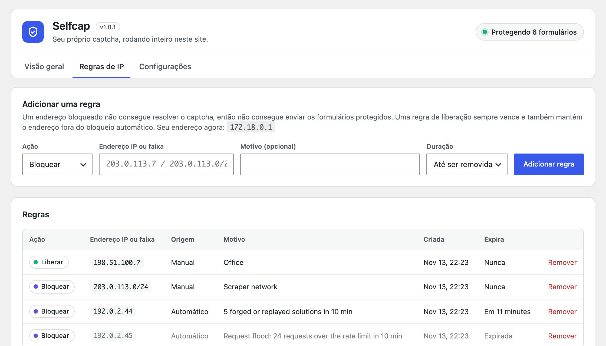
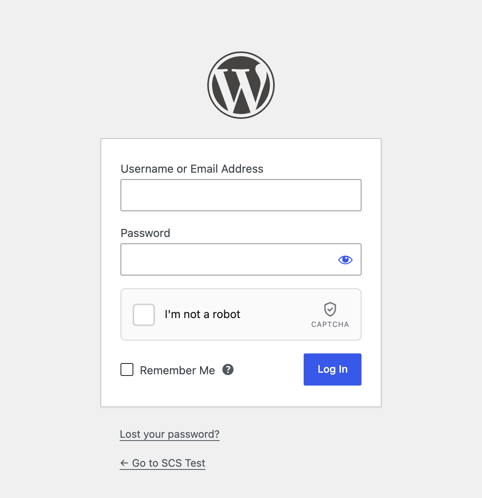
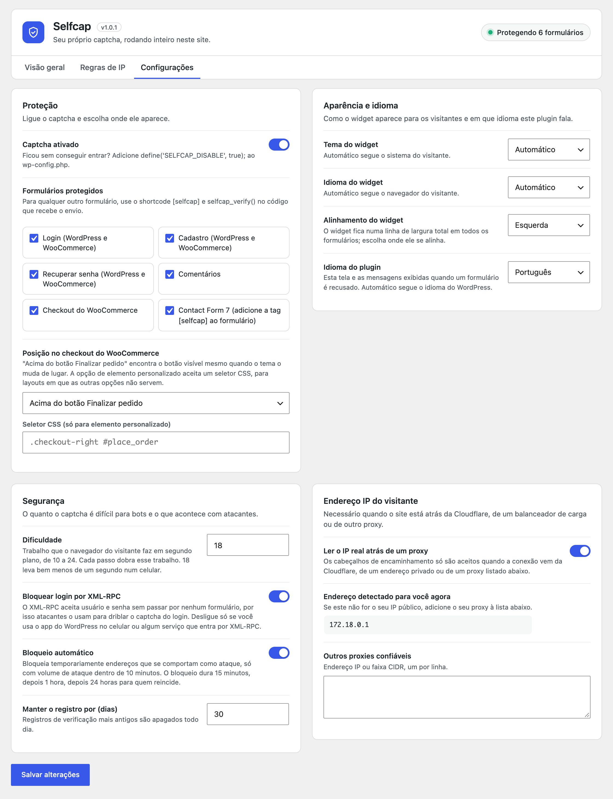
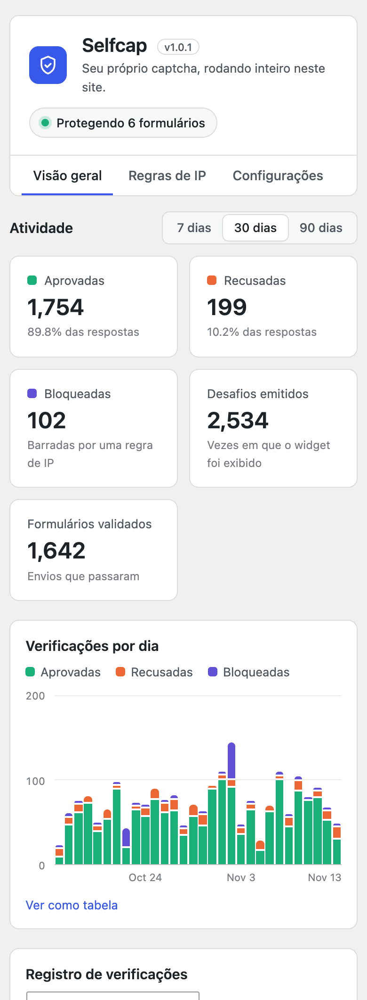
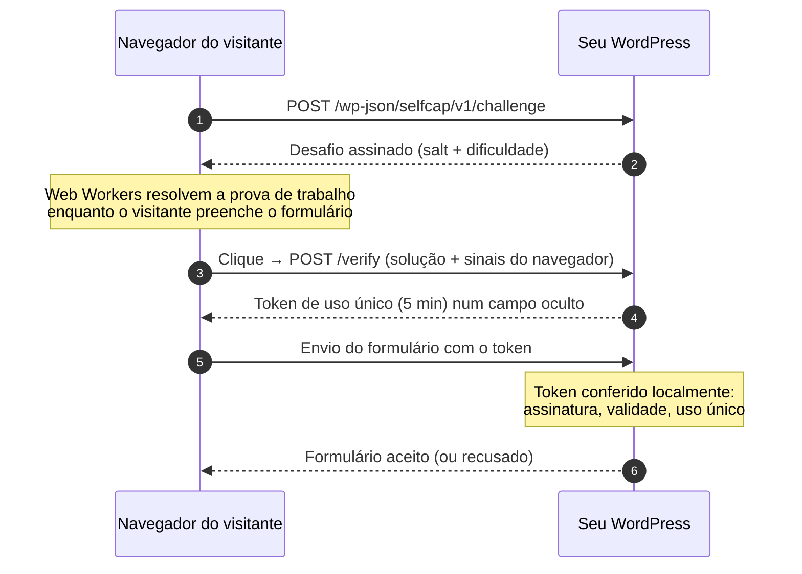

<p align="center">
  
</p>

<p align="center">
  
  
  
  
  
</p>

<p align="center">
  <a href="README.md">English</a> &nbsp;·&nbsp; <b>Português</b> &nbsp;·&nbsp; <a href="README.es.md">Español</a>
</p>

---

O **Selfcap** protege os formulários do seu WordPress com uma caixinha simples de *"Não sou um robô"*, e tudo acontece no seu próprio site. O WordPress emite o desafio, confere a resposta, guarda o registro e bloqueia atacantes. Não há serviço de terceiros, conta para criar, chaves de API nem nada enviado para outra empresa.

<p align="center">
  <picture>
    <source media="(prefers-color-scheme: dark)" srcset="docs/images/widget-pt-dark.png">
    
  </picture>
</p>

## Sumário

- [Por que um captcha próprio](#por-que-um-captcha-próprio)
- [Recursos](#recursos)
- [Capturas de tela](#capturas-de-tela)
- [Como funciona](#como-funciona)
- [Requisitos](#requisitos)
- [Instalação](#instalação)
- [Primeiros passos](#primeiros-passos)
- [Formulários suportados](#formulários-suportados)
- [Configurações](#configurações)
- [Protegendo seus próprios formulários](#protegendo-seus-próprios-formulários)
- [Hooks e constantes](#hooks-e-constantes)
- [API REST](#api-rest)
- [Modelo de segurança](#modelo-de-segurança)
- [Limitações conhecidas](#limitações-conhecidas)
- [IP do visitante atrás de um proxy](#ip-do-visitante-atrás-de-um-proxy)
- [Privacidade e dados](#privacidade-e-dados)
- [Solução de problemas](#solução-de-problemas)
- [Desenvolvimento](#desenvolvimento)
- [Como contribuir](#como-contribuir)
- [Licença](#licença)

## Por que um captcha próprio

Os serviços de captcha hospedados funcionam bem, mas têm um preço: o navegador de cada visitante conversa com outra empresa, você precisa de conta e chaves, e depende da disponibilidade e dos termos de outra pessoa. O Selfcap mantém tudo dentro do seu WordPress.

| | Serviço de captcha hospedado | Selfcap |
|---|---|---|
| Navegador do visitante fala com terceiros | Sim | **Não** |
| Conta e chaves de API | Obrigatórias | **Nenhuma** |
| Onde ficam os dados das verificações | Servidores do provedor | **Seu banco de dados** |
| Funciona em intranet ou homologação offline | Geralmente não | **Sim** |
| Quebra-cabeças ou grades de imagens | Às vezes | **Nunca, um clique** |
| Registro de cada verificação, com motivos | Limitado | **Completo, no wp-admin** |

## Recursos

**Proteção**

- 🧮 **Prova de trabalho.** O navegador do visitante resolve um pequeno cálculo SHA-256 em Web Workers enquanto a página carrega. Pessoas não percebem; um bot que envia milhares de requisições paga por cada uma.
- 🕵️ **Sinais do navegador.** Navegadores automatizados (`webdriver`), cliques disparados por script, tempos de clique impossíveis e user agents falsos são recusados.
- 🎟️ **Tokens de uso único.** Cada captcha resolvido é assinado, preso ao seu site e ao endereço do visitante, e vale para um único envio de formulário em até 5 minutos. Tokens resolvidos em outro lugar (uma fazenda de solvers) são recusados.
- 📈 **Limite de requisições e dificuldade adaptativa.** A cada 10 desafios que um endereço pede em 10 minutos, os próximos ficam duas vezes mais difíceis. No IPv6 a contagem é por /64, então trocar de endereço não adianta.
- 🚫 **Bloqueio automático.** Endereços que se comportam como ataque são bloqueados temporariamente: 15 minutos, depois 1 hora, depois 24 horas para reincidentes. Um cliente de verdade que erra algumas vezes nunca é bloqueado, nem as outras pessoas que dividem o endereço com ele.
- 🔒 **Sem portas laterais.** O login por XML-RPC fica fechado, os formulários do WordPress e do WooCommerce dividem a mesma opção para um não servir de atalho para o outro, e nenhum campo da requisição consegue desligar uma verificação.
- 🧱 **Regras de IP.** Bloqueie ou libere qualquer endereço ou faixa CIDR (IPv4 e IPv6), para sempre ou por um tempo.

**Formulários**

- 🔐 Login, cadastro, recuperar senha e comentários, no `wp-login.php`, no Minha conta do WooCommerce e no cadastro do multisite
- 🛒 Checkout do WooCommerce, **tanto** em blocos quanto no clássico `[woocommerce_checkout]`, com o widget logo acima do botão *Finalizar pedido*, além da página *Pagar pedido*
- ✉️ Contact Form 7, com a tag `[selfcap]`
- 🧩 Qualquer outro formulário, com o shortcode `[selfcap]` e `selfcap_verify()`

**Painel**

- 📊 Totais e gráfico diário dos últimos 7, 30 ou 90 dias, responsivo e acessível por teclado, com visão em tabela
- 📜 Registro de verificações com resultado, pontuação, motivos, IP e navegador, com filtros e 10/25/50 por página
- ⚙️ Configurações agrupadas em cartões claros, com um selo que mostra quantos formulários estão protegidos

**Em todo lugar**

- 🌍 Inglês, português e espanhol, no widget e no admin
- 🌗 Tema do widget claro, escuro ou automático
- ☁️ IP real do visitante atrás da Cloudflare, de um balanceador de carga ou do seu próprio proxy
- 🧹 Limpeza diária dos dados antigos e limpeza completa ao excluir o plugin
- 🪶 Cerca de 12 KB de JavaScript no widget, sem dependências e sem cookies

## Capturas de tela

<table>
  <tr>
    <td width="50%"><br><sub><b>Visão geral.</b> Totais, gráfico diário e o registro de verificações.</sub></td>
    <td width="50%"><br><sub><b>Checkout do WooCommerce.</b> O widget fica logo acima de <i>Finalizar pedido</i>.</sub></td>
  </tr>
  <tr>
    <td><br><sub><b>Regras de IP.</b> Bloqueios manuais e automáticos, com validade.</sub></td>
    <td><br><sub><b>Login.</b> Funciona em todos os formulários do WordPress.</sub></td>
  </tr>
</table>

<details>
<summary>Telas de <b>configurações</b> e <b>celular</b></summary>
<br>
<p align="center">
  
  &nbsp;
  
</p>
</details>

## Como funciona



1. Quando a página carrega, o widget pede ao seu site um **desafio assinado**. Os desafios não guardam estado (HMAC), então não custam nada para armazenar.
2. **Web Workers** procuram um número cujo hash SHA-256, junto com o salt do desafio, começa com uma certa quantidade de bits zero. Na dificuldade padrão isso leva bem menos de um segundo num celular.
3. Quando o visitante clica na caixinha, o widget envia a solução e alguns **sinais do navegador** (o clique foi real, quanto tempo depois do widget aparecer, o ponteiro se mexeu, é um `webdriver`…). O site dá uma pontuação para eles.
4. Se tudo estiver certo, o site devolve um **token de uso único**, que o widget coloca num campo oculto `captcha-response`.
5. Quando o formulário é enviado, o plugin **valida o token localmente**: assinatura, validade e "nunca usado antes". Um token funciona exatamente uma vez.

Nada desse fluxo sai do seu servidor.

## Requisitos

| | Mínimo |
|---|---|
| WordPress | 6.3 |
| PHP | 7.4 (testado até 8.3) |
| Banco de dados | MySQL ou MariaDB, nas versões suportadas pelo WordPress |
| Navegador | Qualquer navegador moderno. Usa Web Workers quando permitido, com alternativa na thread principal |
| API REST | A rota `/wp-json/selfcap/v1/` precisa estar acessível para visitantes |

WooCommerce e Contact Form 7 são opcionais. As opções deles só aparecem nas configurações quando esses plugins estão ativos.

## Instalação

**A partir de um zip**

1. Baixe o `selfcap-x.y.z.zip`, ou gere um a partir do código com `bin/build-zip.sh`.
2. No wp-admin, vá em **Plugins → Adicionar novo → Enviar plugin**, escolha o zip e ative.

**A partir do código**

```bash
cd wp-content/plugins
git clone https://github.com/christianoerick/selfcap.git
wp plugin activate selfcap
```

Ao ativar, o plugin cria suas quatro tabelas e uma chave de assinatura aleatória. Não há mais nada para configurar.

## Primeiros passos

1. **Ative o plugin.** Login, cadastro, recuperar senha e comentários ficam protegidos na hora.
2. Abra **Selfcap → Configurações** e marque os outros formulários que quer proteger (WooCommerce, Contact Form 7).
3. **Só no Contact Form 7:** adicione a tag `[selfcap]` em cada formulário, onde o widget deve aparecer.
4. Saia do admin e abra a página de login. O widget aparece; a verificação é um clique.

> [!TIP]
> Ficou sem conseguir entrar depois de mudar alguma configuração? Adicione `define('SELFCAP_DISABLE', true);` ao `wp-config.php`. O captcha fica desligado até você remover a linha.

## Formulários suportados

| Opção | Onde o widget aparece | Como o envio é conferido |
|---|---|---|
| **Login** | `wp-login.php` e os formulários de login do WooCommerce | `authenticate` no `wp-login.php`, `woocommerce_process_login_errors` no WooCommerce. O login por XML-RPC fica fechado (veja Configurações) |
| **Cadastro** | `wp-login.php?action=register`, Minha conta do WooCommerce, `wp-signup.php` do multisite | `registration_errors`, `woocommerce_process_registration_errors`, `wpmu_validate_user_signup` |
| **Recuperar senha** | `wp-login.php?action=lostpassword` e Minha conta do WooCommerce | `lostpassword_post`, disparado pelos dois. Administradores que enviam o link de redefinição pela tela de Usuários não são afetados |
| **Comentários** | Acima do botão de enviar (oculto para moderadores) | `preprocess_comment`. Pingbacks e trackbacks não são afetados |
| **Checkout do WooCommerce** | Acima de *Finalizar pedido* no checkout em blocos e na página *Pagar pedido*; no checkout clássico, onde você escolher (veja Configurações) | Store API (`woocommerce_store_api_checkout_update_order_from_request`, ao fechar o pedido), `woocommerce_after_checkout_validation`, `woocommerce_before_pay_action` |
| **Contact Form 7** | Onde você colocar `[selfcap]` | `wpcf7_spam`. Só formulários que têm a tag são conferidos |

Cada opção cobre todos os formulários do mesmo tipo: proteger o *Login* protege o `wp-login.php` **e** o login do WooCommerce, então um nunca serve de atalho para o outro.

Formulários que enviam sem recarregar a página já são tratados: depois de uma tentativa recusada o widget pede de novo, e no checkout clássico ele sobrevive à atualização de totais do WooCommerce sem perder uma verificação já feita.

## Configurações

Todas as configurações ficam em **Selfcap → Configurações**.

| Configuração | Padrão | O que faz |
|---|---|---|
| Captcha ativado | Ligado | Chave geral |
| Formulários protegidos | Login, cadastro, recuperar senha, comentários | Onde o widget aparece e é conferido |
| Bloquear login por XML-RPC | Ligado | Fecha o login por XML-RPC, o atalho clássico para driblar um captcha de login. Desligue só para o app do WordPress no celular ou um serviço que entra por XML-RPC |
| Tema do widget | Automático | Claro, escuro, ou segue o sistema do visitante |
| Idioma do widget | Automático | Inglês, português, espanhol, ou segue o navegador do visitante |
| Alinhamento do widget | Esquerda | Esquerda, centro ou direita. O widget mantém a própria largura dentro de uma linha de largura total |
| Posição no checkout do WooCommerce | Acima do botão Finalizar pedido | Checkout clássico: acima do botão *Finalizar pedido* visível (acompanha o botão quando o tema o muda de lugar ou duplica), antes ou depois do pagamento, antes ou depois dos dados de cobrança, ou antes de qualquer elemento indicado por um seletor CSS |
| Idioma do plugin | Automático | Idioma da tela do admin e das mensagens de erro. Automático segue o WordPress |
| Dificuldade | 18 | Bits da prova de trabalho, de 10 a 24. Cada passo dobra o trabalho |
| Bloqueio automático | Ligado | Bloqueios temporários com volume de ataque |
| Manter o registro por | 30 dias | Registros mais antigos são apagados todo dia |
| Ler o IP real atrás de um proxy | Ligado | Aceita cabeçalhos de encaminhamento da Cloudflare, de endereços privados e dos proxies abaixo |
| Outros proxies confiáveis | Vazio | IPs ou faixas CIDR extras que podem enviar cabeçalhos de encaminhamento |

## Protegendo seus próprios formulários

**Shortcode no formulário, uma função no código que recebe o envio.**

```php
<form method="post" action="<?php echo esc_url(admin_url('admin-post.php')); ?>">
    <input type="hidden" name="action" value="minha_newsletter">
    <input type="email" name="email" required>

    <?php echo do_shortcode('[selfcap]'); ?>

    <button type="submit">Assinar</button>
</form>
```

```php
add_action('admin_post_nopriv_minha_newsletter', 'minha_newsletter');
add_action('admin_post_minha_newsletter', 'minha_newsletter');

function minha_newsletter(): void
{
    if (! selfcap_verify()) {
        wp_die('Confirme que você não é um robô.', '', ['response' => 403, 'back_link' => true]);
    }

    // ...o envio veio de uma pessoa, siga em frente.
}
```

`selfcap_verify()` lê o token de `$_POST['captcha-response']`. Você também pode passar o token: `selfcap_verify($token)`. Ela devolve `true` ou `false`, e chamar duas vezes na mesma requisição não gasta o token duas vezes.

**Atributos do shortcode**

| Atributo | Valores | Padrão |
|---|---|---|
| `theme` | `auto`, `light`, `dark` | A configuração |
| `language` | `auto`, `en`, `pt`, `es` | A configuração |
| `align` | `left`, `center`, `right` | A configuração |

```text
[selfcap theme="dark" language="pt"]
```

**API JavaScript.** Formulários que enviam com `fetch` ou AJAX podem usar a API do widget para ler o token e pedir de novo depois de uma recusa:

```js
const caixa = document.querySelector('#meu-form .self-captcha');

const token = SelfCaptcha.getResponse(caixa); // '' até o visitante marcar a caixinha
// ...envia o formulário com o token...
SelfCaptcha.reset(caixa);                     // o token foi gasto: mostra uma caixinha nova
```

| Método | O que faz |
|---|---|
| `SelfCaptcha.getResponse(alvo?)` | Token atual, ou `''` |
| `SelfCaptcha.reset(alvo?)` | Volta para a caixinha desmarcada com um desafio novo |
| `SelfCaptcha.render(elemento, opções?)` | Renderiza um widget adicionado depois do carregamento da página |
| `SelfCaptcha.remove(alvo?)` | Remove um widget |

`alvo` é o elemento do container, um seletor CSS ou o id devolvido por `render()`; sem ele, vale o primeiro widget da página.

## Hooks e constantes

Filtro **`selfcap_config`**: todos os valores de ajuste num único array.

```php
add_filter('selfcap_config', function (array $config): array {
    $config['token_ttl'] = 900;                // checkouts demorados
    $config['auto_block']['durations'] = [30, 240, 2880];

    return $config;
});
```

<details>
<summary>Todas as chaves e seus padrões</summary>

| Chave | Padrão | Significado |
|---|---|---|
| `challenge_ttl` | `180` | Segundos de validade de um desafio |
| `token_ttl` | `300` | Segundos de validade de um token antes do envio do formulário |
| `bind_token_ip` | `true` | O formulário precisa vir do endereço (do /64 no IPv6) que resolveu o captcha |
| `difficulty` | configuração (`18`) | Bits base da prova de trabalho |
| `min_difficulty` / `max_difficulty` | `10` / `24` | Limites, já com o bônus adaptativo |
| `adaptive_step` | `10` | Desafios por IP em 10 minutos que somam um bit |
| `adaptive_max_bonus` | `5` | Máximo de bits extras |
| `score_block` | `100` | Uma verificação com essa pontuação ou mais é recusada |
| `min_click_ms` | `250` | Cliques mais rápidos que isso depois do widget aparecer são recusados |
| `rate.challenge` / `rate.verify` | `30` / `30` | Requisições por minuto por IP |
| `auto_block.enabled` | configuração (ligado) | Chave do bloqueio automático |
| `auto_block.window` | `600` | Janela de contagem, em segundos |
| `auto_block.fails` | `8` | Verificações recusadas que disparam o bloqueio… |
| `auto_block.fail_ratio` | `4` | …a não ser que as aprovadas × 4 superem as recusadas (vale também para `rate_limited`) |
| `auto_block.bad_solutions` | `10` | Soluções erradas ou repetidas para desafios legítimos |
| `auto_block.bot_signals` | `5` | Verificações marcadas como automação |
| `auto_block.login_fails` | `20` | Logins com senha errada |
| `auto_block.rate_limited` | `20` | Requisições recusadas pelo limite |
| `auto_block.passes` | `100` | Verificações aprovadas (só volume extremo) |
| `auto_block.wide_after` | `16` | /64 de um mesmo /48 do IPv6 bloqueados por automação, recusas ou senhas erradas em um dia, que bloqueiam o /48 inteiro |
| `auto_block.durations` | `[15, 60, 1440]` | Minutos de bloqueio na 1ª, 2ª e demais ocorrências |
| `auto_block.memory_days` | `7` | Por quanto tempo as ocorrências anteriores são lembradas |

</details>

Filtro **`selfcap_hostnames`**: domínios extras onde o widget pode rodar (mapeamento de domínio, um segundo domínio de idioma). As URLs do site e da home sempre são aceitas, com e sem `www.`.

```php
add_filter('selfcap_hostnames', fn (array $hosts) => [...$hosts, 'loja.exemplo.com.br']);
```

Constante **`SELFCAP_DISABLE`**: `define('SELFCAP_DISABLE', true);` no `wp-config.php` desliga tudo.

Função **`selfcap_verify(?string $token = null): bool`**: valida o envio atual, como mostrado acima.

## API REST

O widget conversa com duas rotas públicas do seu próprio site. Você só precisa delas se for construir o seu próprio widget.

| Rota | Corpo | Sucesso |
|---|---|---|
| `POST /wp-json/selfcap/v1/challenge` | `{}` | `{ success, challenge, salt, difficulty, expires_in }` |
| `POST /wp-json/selfcap/v1/verify` | `{ challenge, nonce, signals }` | `{ success, token, expires_in }` |

Os erros voltam como `{ "success": false, "error": "<código>" }`:

| Código | Significado |
|---|---|
| `domain-not-allowed` | A requisição não veio das páginas deste site |
| `blocked` | O endereço bate com uma regra de bloqueio |
| `rate-limited` | Requisições demais deste endereço no último minuto |
| `invalid-challenge` / `challenge-expired` / `challenge-used` | Desafio forjado, vencido ou já usado |
| `ip-mismatch` | O desafio foi emitido para outro endereço |
| `invalid-solution` | A prova de trabalho não confere |
| `verification-failed` | Os sinais do navegador pontuaram como bot |
| `site-disabled` | O captcha está desligado |

## Modelo de segurança

Vale ser claro sobre o que um captcha consegue e o que não consegue fazer. **Sinais do navegador podem ser falsificados** por um atacante dedicado que escreva um bot especificamente para o seu site. O que torna o abuso caro é a combinação:

- a **prova de trabalho**, paga a cada tentativa e mais difícil conforme o volume cresce;
- o **limite de requisições** por endereço;
- **tokens de uso único**, que não podem ser repetidos, compartilhados entre sites nem usados de um endereço diferente do que os resolveu — e nunca de um endereço bloqueado;
- o **bloqueio automático** de endereços que insistem em falhar, forjar ou inundar;
- **nenhuma porta lateral**: login por XML-RPC fechado, uma opção por tipo de formulário, verificações decididas pelo ponto de entrada e nunca por um campo enviado pelo cliente;
- um **widget blindado**: ele só conversa com o seu próprio site e só aceita respostas bem formadas, então HTML injetado num post não consegue usá-lo contra um administrador.

<details>
<summary>Como uma verificação é pontuada</summary>

Uma verificação é recusada com pontuação **100** ou mais.

| Sinal | Pontos |
|---|---|
| Flag `webdriver` informada pelo navegador | 100 |
| User agent de bot (headless, curl, python-requests…) | 100 |
| Clique não confiável (disparado por script) | 100 |
| Clique menos de 250 ms depois do widget aparecer | 100 |
| User agent da página diferente do cabeçalho da requisição | 50 |
| Clique de mouse sem movimento do ponteiro | 40 |
| Sem cabeçalho `Accept-Language` | 30 |
| Navegador sem idiomas | 30 |
| Sem tamanho de tela | 30 |
| Diz ser Chrome sem o runtime do Chrome | 30 |
| Sem tamanho de janela | 20 |
| Nenhuma atividade do usuário na página | 20 |

Quem usa teclado ou toque é avaliado pelas próprias regras: ninguém espera movimento de ponteiro deles.

</details>

<details>
<summary>Quando um endereço é bloqueado automaticamente</summary>

A contagem é por endereço IPv4, ou por **/64** no IPv6, dentro de 10 minutos.

| Gatilho | Limite | Por que um cliente nunca chega lá |
|---|---|---|
| Verificações recusadas | 8, e só se as aprovadas × 4 não superarem as recusadas | Aprovações de um IP compartilhado (escritório, operadora) seguram o bloqueio |
| Soluções erradas ou repetidas para desafios legítimos | 10 | O widget de verdade nunca envia isso. Lixo sem assinatura não conta, porque não custa nada enviar |
| Automação de navegador detectada | 5 | Navegadores comuns não acusam `webdriver` |
| Logins com senha errada | 20 | Ninguém erra a própria senha 20 vezes em 10 minutos |
| Requisições acima do limite | 20 | Já significa mais de 30 requisições por minuto |
| Captchas resolvidos por um endereço | 100 | Ninguém preenche 100 formulários em 10 minutos |

Para verificações recusadas e inundação de requisições, as verificações aprovadas do mesmo endereço seguram o bloqueio (aprovadas × 4 precisam ficar abaixo da contagem), então uma pessoa mal-intencionada atrás de um NAT de operadora, de um escritório ou de uma escola não consegue fazer todo mundo ser bloqueado. Os outros gatilhos bloqueiam direto, então um bot não consegue proteger o próprio endereço resolvendo alguns captchas antes. No IPv6, 16 /64 de um mesmo /48 bloqueados em um dia por automação, recusas ou senhas erradas bloqueiam o /48 inteiro.

O bloqueio dura **15 minutos**, depois **1 hora**, depois **24 horas** para reincidências em 7 dias. **Regras de liberação sempre vencem**, e **endereços privados nunca são bloqueados**: se o seu proxy não for reconhecido, todos os visitantes dividiriam o endereço dele, e bloqueá-lo bloquearia todo mundo.

</details>

## Limitações conhecidas

- **Botões de pagamento expresso** (Apple Pay, Google Pay e botões parecidos que aparecem antes do formulário de checkout) fecham o pedido sem o widget. Com o *Checkout do WooCommerce* protegido, eles são recusados até o visitante marcar a caixinha. Teste na sua loja e desligue a opção do checkout se depender deles.
- **Formulários próprios de outros plugins** para login ou cadastro (login AJAX de um tema, um plugin de assinaturas) não mostram o widget, então não são conferidos. Proteja-os com o shortcode e `selfcap_verify()`.
- **Usuários logados** que comentam pela API REST não passam pelo captcha; é no cadastro que os bots são barrados.
- **Uma CDN ou proxy com endereços públicos** que não seja a Cloudflare (CloudFront, Sucuri, Fastly…) precisa ser listada em *Outros proxies confiáveis*. Até lá, todos os visitantes dividem os endereços da CDN.

## IP do visitante atrás de um proxy

Atrás da Cloudflare, de um balanceador de carga ou de um proxy reverso, a conexão vem do proxy, não do visitante. O plugin lê os cabeçalhos de encaminhamento (`CF-Connecting-IP`, `X-Forwarded-For`) **somente** quando a própria conexão vem de:

- **Cloudflare**, pelas faixas IPv4 e IPv6 que ela publica;
- um **endereço privado** (balanceadores da AWS, Google Cloud ou Azure, Docker, um Nginx local);
- um proxy que você listar em **Outros proxies confiáveis**.

Um visitante que se conecta direto não consegue falsificar esses cabeçalhos. A tela de configurações mostra o endereço detectado para você agora; se não for o seu IP público, adicione o seu proxy à lista. Atrás do CloudFront, liste lá as faixas do CloudFront.

## Privacidade e dados

- **Nenhuma requisição externa.** Nem o widget nem o plugin falam com qualquer serviço de fora. Nenhum cookie é criado.
- **O que é guardado**, no seu próprio banco, para cada verificação: endereço IP, user agent, domínio, pontuação, resultado, motivos e tempo de resolução. Por padrão fica por 30 dias.
- **Política de privacidade.** Um parágrafo sugerido é adicionado em **Configurações → Privacidade** para você incluir na sua política.

| Tabela | Guarda |
|---|---|
| `{prefix}selfcap_log` | Uma linha por verificação |
| `{prefix}selfcap_stats` | Totais diários (mantidos por cerca de 13 meses) |
| `{prefix}selfcap_rules` | Regras de IP manuais e automáticas |
| `{prefix}selfcap_counters` | Contadores de vida curta: limite de requisições, detecção de ataque, tokens usados |

Uma tarefa diária do cron apaga os dados vencidos. **Excluir o plugin** pela tela de Plugins remove as quatro tabelas, as opções e as preferências dos usuários.

## Solução de problemas

<details>
<summary><b>O widget diz "Verificação indisponível" ou "Falha na verificação"</b></summary>

- **"Verificação indisponível"** significa que o site recusou o widget: o captcha está desligado, ou a página está num domínio diferente do site WordPress. Adicione esse domínio com o filtro `selfcap_hostnames`.
- **"Falha na verificação"** logo depois do clique, toda vez, geralmente significa que o widget não alcança `/wp-json/selfcap/v1/`. Confira se algum plugin de segurança ou regra de firewall está fechando a API REST para visitantes. O registro na **Visão geral** mostra o motivo quando a requisição chegou.
</details>

<details>
<summary><b>Todo mundo aparece com o mesmo IP no registro</b></summary>

O site está atrás de um proxy que o plugin não reconhece; a tela do admin mostra um aviso quando isso acontece. Abra **Configurações → Endereço IP do visitante**, compare o endereço detectado com o seu, e adicione o proxy em **Outros proxies confiáveis**. Até lá o bloqueio automático não age sobre endereços privados, então ninguém fica trancado do lado de fora.
</details>

<details>
<summary><b>Não consigo mais entrar no admin</b></summary>

Adicione `define('SELFCAP_DISABLE', true);` ao `wp-config.php`, entre, corrija a configuração e remova a linha. Ou adicione o seu IP como regra de **Liberar**.
</details>

<details>
<summary><b>O checkout demora mais que 5 minutos</b></summary>

O widget se renova sozinho quando o token vence, então o visitante só clica de novo. Para dar mais tempo, aumente `token_ttl` com o filtro `selfcap_config`.
</details>

<details>
<summary><b>Funciona com cache de página?</b></summary>

Sim. A página pode ser cacheada normalmente; o widget busca o desafio numa requisição separada, sem cache, depois que a página carrega.
</details>

<details>
<summary><b>Posso usar junto com outro plugin de captcha?</b></summary>

Pode, mas não há motivo para proteger o mesmo formulário duas vezes. Desligue o outro plugin nos formulários escolhidos aqui.
</details>

## Desenvolvimento

```text
selfcap/
├── selfcap.php   Inicialização: constantes, includes, hooks
├── includes/
│   ├── class-selfcap-engine.php  Desafio, prova de trabalho, pontuação, tokens, bloqueio automático
│   ├── class-selfcap-store.php   Tabelas, contadores, registro, totais, regras de IP
│   ├── class-selfcap-ip.php      Faixas CIDR e IP real do visitante
│   ├── class-selfcap-plugin.php  Opções, traduções, HTML do widget, verify()
│   ├── class-selfcap-rest.php    As duas rotas REST
│   ├── class-selfcap-forms.php   Hooks do WordPress, WooCommerce e Contact Form 7
│   └── class-selfcap-admin.php   A tela do admin
├── assets/
│   ├── widget.js                 Widget compilado (código em assets/src/)
│   ├── forms.js                  Integração com formulários AJAX e os dois checkouts
│   ├── admin.css / admin.js      Tela do admin
│   └── src/                      Código legível do widget
├── languages/                    .pot, pt_BR e es_ES
├── tests/run.php                 Testes de integração
└── bin/build-zip.sh              Gera o zip de distribuição
```

**Recompile o widget** depois de mudar `assets/src/`:

```bash
npx esbuild assets/src/widget.js --bundle --minify --format=iife --target=es2017 --outfile=assets/widget.js
```

**Rode os testes** num site descartável. Eles esvaziam as tabelas do plugin.

```bash
wp eval-file wp-content/plugins/selfcap/tests/run.php
# OK - 93 checks passed
```

Eles cobrem o fluxo completo, desafios e tokens forjados ou repetidos, tokens usados de outro endereço ou de um endereço bloqueado, conferência de domínio, sinais do navegador, regras de IP (inclusive com milhares de regras automáticas), limite de requisições e dificuldade adaptativa, cada gatilho do bloqueio automático, senhas erradas, endereços compartilhados, o /64 e o /48 do IPv6, a detecção de IP atrás de proxy e a limpeza dos dados.

**Atualize as traduções** depois de mudar um texto:

```bash
wp i18n make-pot . languages/selfcap.pot --exclude=tests,assets,docs
# traduza languages/*.po e depois:
wp i18n make-mo languages
```

**Gere o zip de distribuição** (só os arquivos que vão no plugin, veja `.distignore`):

```bash
bin/build-zip.sh
# dist/selfcap-1.0.1.zip
```

O plugin passa no [Plugin Check](https://wordpress.org/plugins/plugin-check/) oficial sem erros nem avisos:

```bash
wp plugin check selfcap
```

## Como contribuir

Issues e pull requests são bem-vindos. Por favor:

1. Abra uma issue antes para mudanças maiores, para combinarmos a abordagem.
2. Mantenha o plugin sem dependências e com tudo dentro do site: nada de chamadas externas.
3. Rode os testes e o Plugin Check antes de enviar o pull request.
4. Adicione todo texto novo visível ao usuário nos três idiomas.

Encontrou uma falha de segurança? Não abra uma issue pública; use o **relato privado de vulnerabilidade** do GitHub neste repositório.

## Licença

[GPL-2.0-or-later](LICENSE). © Christiano Erick.
